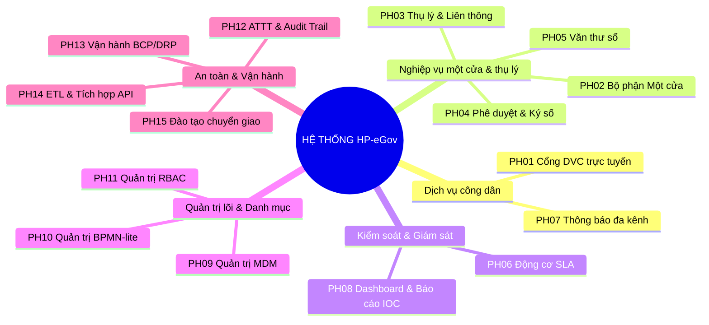
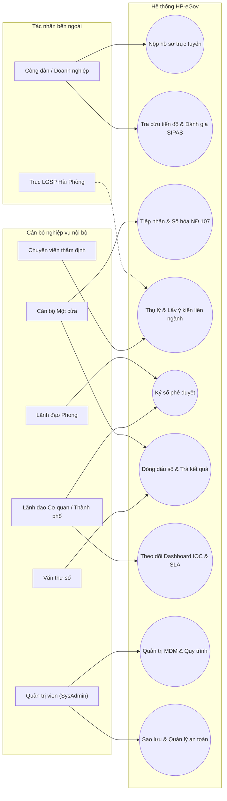
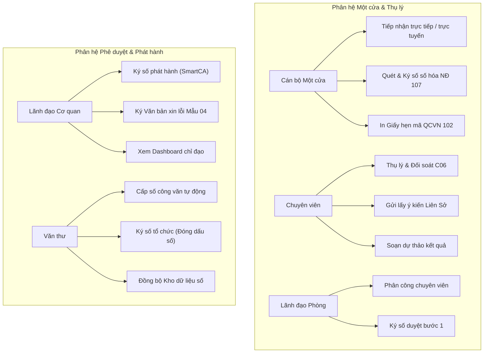
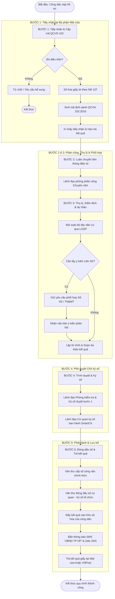
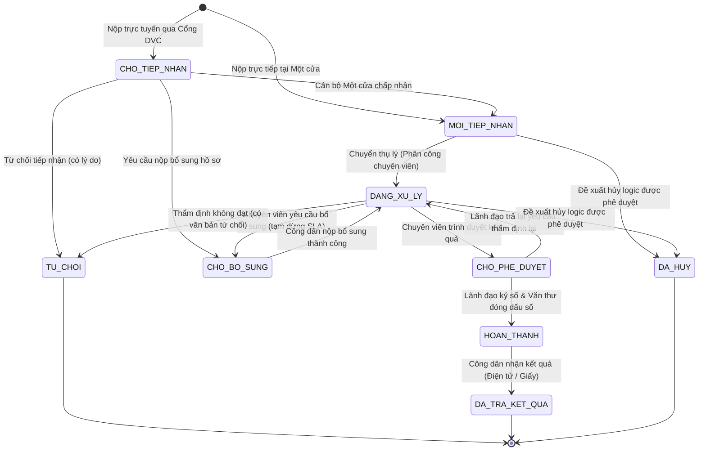
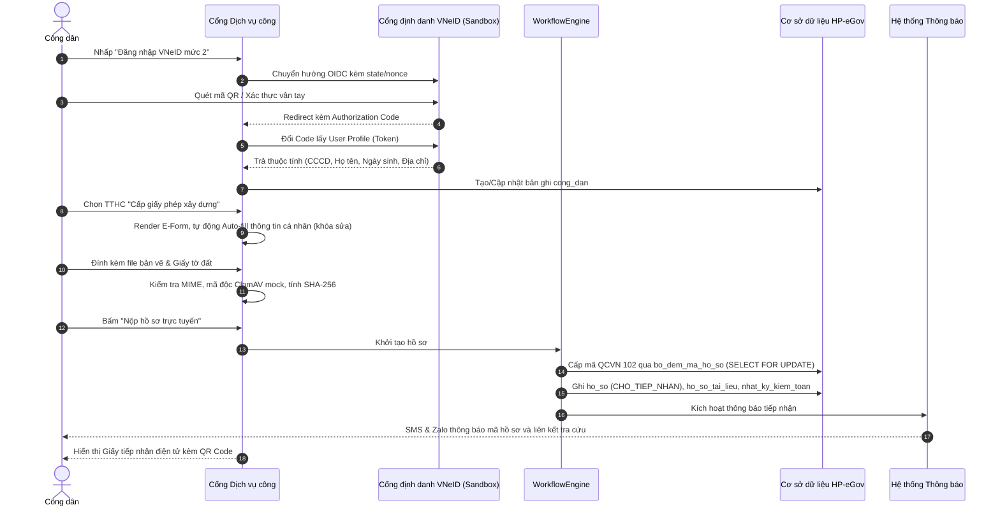
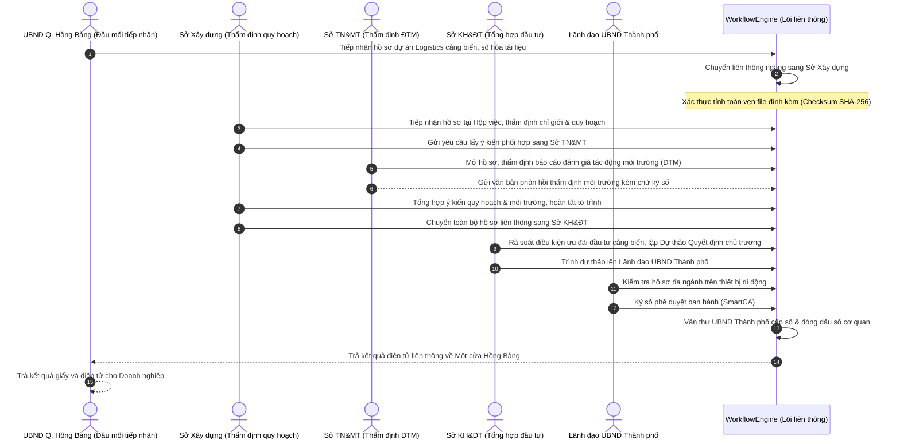
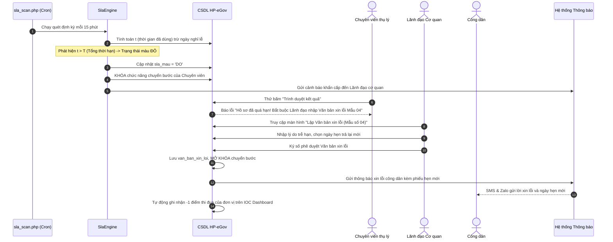
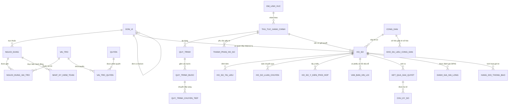
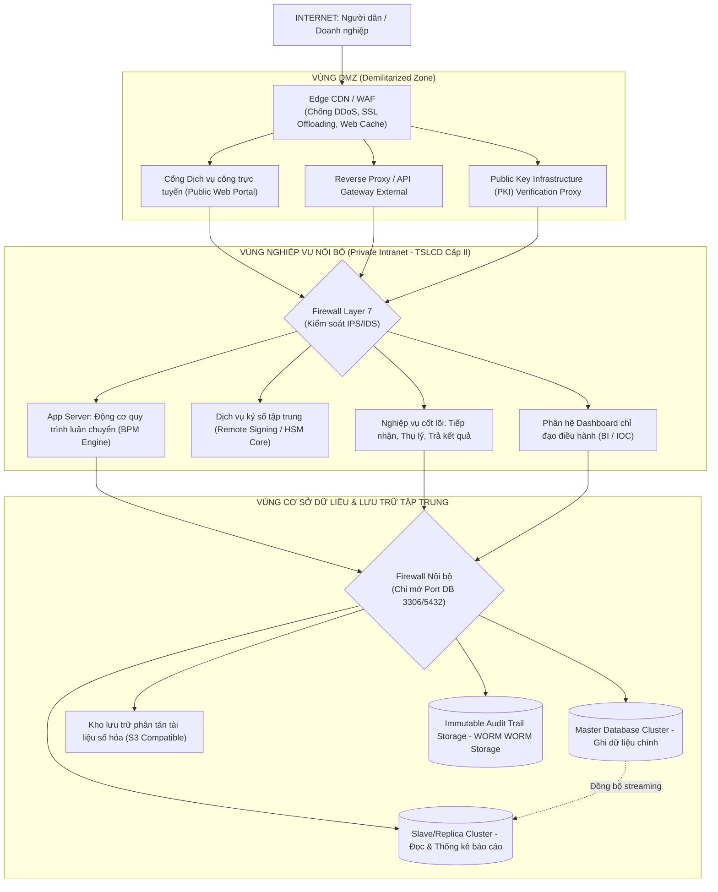

# TÀI LIỆU PHÂN TÍCH & THIẾT KẾ HỆ THỐNG HP-eGov
## HỆ THỐNG THÔNG TIN QUẢN LÝ HÀNH CHÍNH & MỘT CỬA ĐIỆN TỬ LIÊN THÔNG TP. HẢI PHÒNG

> **Căn cứ tài liệu gốc:** `Báo cáo Kiến trúc & Kế hoạch Triển khai HP-eGov.pdf` (17 trang)  
> **Cơ quan chủ quản:** Ủy ban nhân dân Thành phố Hải Phòng  
> **Đơn vị thẩm định / Giám sát kỹ thuật:** Sở Thông tin và Truyền thông TP. Hải Phòng  
> **Cấp độ an toàn hệ thống:** Cấp độ 3 (Nghị định 85/2016/NĐ-CP & Thông tư 12/2022/TT-BTTTT)  
> **Phiên bản tài liệu:** v1.0.0 – Phiên 1 (Phân tích & Thiết kế hệ thống)  
> **Tác giả:** Chuyên gia Cao cấp MIS & Kiến trúc sư Giải pháp Chính quyền Điện tử  

---

## MỤC LỤC
1. [Bối cảnh nghiệp vụ & Phạm vi hệ thống](#1-bối-cảnh-nghiệp-vụ--phạm-vi-hệ-thống)
2. [Tác nhân & Mô hình phân quyền RBAC đa cấp (§4.1)](#2-tác-nhân--mô-hình-phân-quyền-rbac-đa-cấp-41)
3. [Danh mục 15 phân hệ & Đặc tả chức năng chi tiết (PH01 – PH15)](#3-danh-mục-15-phân-hệ--đặc-tả-chức-năng-chi-tiết-ph01--ph15)
4. [Yêu cầu phi chức năng & Chỉ tiêu SLA](#4-yêu-cầu-phi-chức-năng--chỉ-tiêu-sla)
5. [Sơ đồ Use Case tổng quát & Theo vai trò](#5-sơ-đồ-use-case-tổng-quát--theo-vai-trò)
6. [Sơ đồ hoạt động 5 bước & Trạng thái hồ sơ (State Machine)](#6-sơ-đồ-hoạt-động-5-bước--trạng-thái-hồ-sơ-state-machine)
7. [Sơ đồ tuần tự (Sequence Diagrams) cho 3 kịch bản trọng yếu](#7-sơ-đồ-tuần-tự-sequence-diagrams-cho-3-kịch-bản-trọng-yếu)
8. [Sơ đồ luồng dữ liệu DFD (Mức 0 & Mức 1)](#8-sơ-đồ-luồng-dữ-liệu-dfd-mức-0--mức-1)
9. [Sơ đồ thực thể liên kết ERD mức khái niệm](#9-sơ-đồ-thực-thể-liên-kết-erd-mức-khái-niệm)
10. [Kiến trúc triển khai 3 vùng mạng & Ánh xạ mô hình MVC](#10-kiến-trúc-triển-khai-3-vùng-mạng--ánh-xạ-mô-hình-mvc)
11. [Sitemap tổng thể & Danh mục Route dự kiến](#11-sitemap-tổng-thể--danh-mục-route-dự-kiến)
12. [Ma trận phân quyền chi tiết (Matrix of Permissions)](#12-ma-trận-phân-quyền-chi-tiết-matrix-of-permissions)
13. [Các giả định thiết kế & Nguyên tắc chuẩn hóa](#13-các-giả-định-thiết-kế--nguyên-tắc-chuẩn-hóa)

---

## 1. BỐI CẢNH NGHIỆP VỤ & PHẠM VI HỆ THỐNG

### 1.1. Bối cảnh đặc thù địa phương TP. Hải Phòng
Thành phố Hải Phòng là đô thị loại I trực thuộc Trung ương, trung tâm kinh tế biển, đầu mối giao thông hàng hải và logistics trọng điểm phía Bắc. Đặc thù của thành phố gắn liền với:
- Mật độ tập trung cao của các khu kinh tế mở (KKT Đình Vũ – Cát Hải), các khu công nghiệp quy mô quốc tế (VSIP, DEEP C, Tràng Duệ, Nam Cầu Kiền).
- Chiến lược nâng cấp và phát triển hạt nhân đô thị mới: chuyển đổi huyện Thủy Nguyên thành thành phố trực thuộc Hải Phòng, tái lập quận An Dương.
- Khối lượng giao dịch hành chính liên ngành về đất đai, cấp phép xây dựng công trình cảng biển, dịch vụ logistics, cấp phù hiệu vận tải container liên tỉnh rất lớn.

### 1.2. Phạm vi liên thông đa chiều
Hệ thống giải quyết triệt để bài toán cát cứ dữ liệu thông qua 2 trục liên thông:
1. **Liên thông dọc:**
   $$\text{Văn phòng UBND Thành phố} \longleftrightarrow \text{UBND 15 Quận/Huyện/Thành phố} \longleftrightarrow \text{UBND Xã/Phường/Thị trấn}$$
2. **Liên thông ngang:** Giữa các Sở chuyên ngành:
   - Sở Kế hoạch & Đầu tư (chủ trì đầu tư dự án)
   - Sở Xây dựng (thẩm định quy hoạch, cấp phép xây dựng)
   - Sở Tài nguyên & Môi trường (thẩm định tác động môi trường ĐTM, giao đất/thuê đất)
   - Sở Giao thông Vận tải (thẩm định đấu nối giao thông cảng, luồng vận tải logistics)

### 1.3. Chu trình sống toàn trình của hồ sơ TTHC
Chu trình khép kín 7 chặng:
$$\text{Tiếp nhận} \longrightarrow \text{Số hóa đầu vào (NĐ 107)} \longrightarrow \text{Luân chuyển nghiệp vụ} \longrightarrow \text{Thẩm định/Phối hợp} \longrightarrow \text{Ký số duyệt} \longrightarrow \text{Đóng dấu số} \longrightarrow \text{Trả kết quả \& Lưu kho số hóa}$$

### 1.4. Bộ chỉ số đo lường hiệu quả cốt lõi (SLA & KPI)
Theo cam kết tại Báo cáo Kiến trúc, hệ thống HP-eGov đo lường bằng 4 chỉ số vàng:
- **Tỷ lệ giải quyết hồ sơ đúng hạn và trước hạn:** $\ge 98\%$
- **Tỷ lệ hồ sơ TTHC tiếp nhận và xử lý toàn trình qua mạng:** $\ge 80\%$
- **Tỷ lệ số hóa hồ sơ, kết quả giải quyết TTHC (NĐ 107/2021/NĐ-CP):** $100\%$
- **Chỉ số hài lòng của người dân, doanh nghiệp (SIPAS):** Đạt tối thiểu $\ge 92\%$

---

## 2. TÁC NHÂN & MÔ HÌNH PHÂN QUYỀN RBAC ĐA CẤP (§4.1)

### 2.1. Cấu trúc quan hệ phân quyền
Hệ thống quản lý định danh người dùng và ủy quyền thao tác theo chuỗi liên kết chặt chẽ:
$$\text{Tài khoản (Account)} \longrightarrow \text{Đơn vị trực thuộc (Node ID)} \longrightarrow \text{Gán vai trò (Roles)} \longrightarrow \text{Ma trận quyền (CRUD Permissions)}$$

### 2.2. Danh sách 7 vai trò nghiệp vụ chuẩn
1. **`CONG_DAN` (Công dân / Tổ chức / Doanh nghiệp):** Đối tượng thụ hưởng dịch vụ hành chính công. Nộp hồ sơ, tra cứu, bổ sung, nhận kết quả điện tử và đánh giá hài lòng.
2. **`CB_MOT_CUA` (Cán bộ tiếp nhận Một cửa):** Trực tiếp tiếp nhận hồ sơ giấy tại Bộ phận Một cửa cấp Xã/Huyện/Sở, tiếp nhận hồ sơ trực tuyến, số hóa hồ sơ theo NĐ 107/2021/NĐ-CP, cấp mã QCVN 102, in Giấy hẹn, trả kết quả.
3. **`CHUYEN_VIEN` (Chuyên viên thẩm định):** Cán bộ thuộc phòng ban chuyên môn được giao quyền thụ lý, kiểm tra hồ sơ, gửi lấy ý kiến phối hợp liên phòng/liên sở, tạo tờ trình, dự thảo giấy phép/quyết định.
4. **`LD_PHONG` (Lãnh đạo Phòng chuyên môn):** Trưởng/Phó phòng chuyên môn. Phân công hồ sơ cho chuyên viên, duyệt tờ trình, điều chỉnh ý kiến thụ lý, ký số duyệt bước 1.
5. **`LD_CO_QUAN` (Lãnh đạo Sở / UBND Quận / UBND Thành phố):** Giám đốc Sở, Chủ tịch/Phó Chủ tịch UBND Quận/Huyện/Thành phố. Xem toàn bộ hồ sơ cơ quan, chỉ đạo xử lý, ký số phê duyệt ban hành (SmartCA/Token), ký văn bản xin lỗi Mẫu 04 khi quá hạn, duyệt hủy logic hồ sơ.
6. **`VAN_THU` (Văn thư số):** Quản lý sổ văn bản đi/đến, cấp số hiệu văn bản chính thức, ký số tổ chức (đóng dấu số cơ quan), phát hành kết quả, chuyển kết quả cho Một cửa và đồng bộ vào Kho dữ liệu điện tử.
7. **`SYSADMIN` (Quản trị viên hệ thống):** Cán bộ kỹ thuật Trung tâm CNTT (Sở TT&TT). Quản lý cấu hình, người dùng, phân quyền, sao lưu, audit log. **Tuyệt đối không can thiệp nghiệp vụ hồ sơ và không có quyền ký số.**

### 2.3. Ma trận phân quyền thao tác nghiệp vụ (CRUD)
Tuân thủ nguyên tắc bảo mật và phân định trách nhiệm (§4.1 Báo cáo):

| Vai trò nghiệp vụ | Xem hồ sơ (Read) | Tạo mới / Tiếp nhận (Create) | Sửa / Thụ lý (Update) | Phê duyệt / Ký số (Execute) | Xóa hồ sơ (Delete) |
|---|---|---|---|---|---|
| **CONG_DAN** | Hồ sơ của chính mình | Nộp hồ sơ mới | Sửa khi có yêu cầu bổ sung | Ký số E-Form | **Tuyệt đối không** |
| **CB_MOT_CUA** | Toàn bộ hồ sơ tại đơn vị | Tiếp nhận giấy / trực tuyến | Bổ sung, chuyển bước | Xác nhận biên nhận | **Tuyệt đối không** |
| **CHUYEN_VIEN** | Hồ sơ được phân công | Tạo tờ trình, biên bản | Thụ lý, dự thảo kết quả | Trình duyệt văn bản | **Tuyệt đối không** |
| **LD_PHONG** | Hồ sơ thuộc phòng | Giao việc chuyên viên | Điều chỉnh ý kiến thụ lý | Ký số duyệt bước 1 | **Tuyệt đối không** |
| **LD_CO_QUAN** | Toàn bộ hồ sơ cơ quan | Không thao tác | Ý kiến chỉ đạo | Ký số phát hành | **Tuyệt đối không** |
| **VAN_THU** | Hồ sơ đã phê duyệt | Tạo sổ phát hành | Nhập số công văn đến/đi | Đóng dấu số cơ quan | **Tuyệt đối không** |
| **SYSADMIN** | Không xem nghiệp vụ | Tạo user / phân quyền | Cấu hình tham số | Không quyền ký số | Xóa cấu hình (*Không xóa data*) |

> [!CAUTION]
> **Nguyên tắc bất biến dữ liệu (§4.1):** Trong CSDL nghiệp vụ TTHC, dữ liệu hồ sơ công dân **không bao giờ bị xóa vật lý (Physical Delete)**. Mọi thao tác hủy bỏ chỉ là cập nhật trạng thái logic (`is_deleted = 1`, `trang_thai = 'DA_HUY'`) kèm căn cứ pháp lý, biên bản giải trình và được phê duyệt bởi Lãnh đạo cơ quan.

---

## 3. DANH MỤC 15 PHÂN HỆ & ĐẶC TẢ CHỨC NĂNG CHI TIẾT (PH01 – PH15)



### PH01: Cổng Dịch vụ công trực tuyến (Citizen Public Portal)
- **Mục tiêu:** Cung cấp điểm truy cập duy nhất cho cá nhân, tổ chức trên Internet phục vụ nộp hồ sơ, tra cứu và đánh giá.
- **Danh mục chức năng:**
  - `FR01.01` – Tra cứu danh mục TTHC: Tìm kiếm đa tiêu chí (từ khóa, cơ quan, lĩnh vực, cấp thực hiện, mức độ dịch vụ một phần/toàn trình). *(Vai trò: Vãng lai/Công dân, Ưu tiên: P1)*
  - `FR01.02` – Đăng nhập định danh VNeID / Doanh nghiệp: Hỗ trợ xác thực qua SSO VNeID mức 2 (OIDC) hoặc tài khoản doanh nghiệp (Mã số thuế). *(Vai trò: Công dân, Ưu tiên: P1)*
  - `FR01.03` – Nộp hồ sơ trực tuyến E-Form: Wizard 4 bước nộp hồ sơ, tự động điền (Auto-fill) dữ liệu từ VNeID (CCCD, họ tên, ngày sinh, nơi thường trú). *(Vai trò: Công dân, Ưu tiên: P1)*
  - `FR01.04` – Tái sử dụng giấy tờ từ Kho số hóa: Cho phép công dân đính kèm tài liệu đã được số hóa từ các lần nộp trước mà không cần nộp lại. *(Vai trò: Công dân, Ưu tiên: P1)*
  - `FR01.05` – Theo dõi tiến độ hồ sơ: Xem chi tiết luồng xử lý 5 bước, tiến trình thời gian thực (ẩn ý kiến trao đổi nội bộ). *(Vai trò: Công dân, Ưu tiên: P1)*
  - `FR01.06` – Nộp bổ sung hồ sơ trực tuyến: Cho phép tải bổ sung tài liệu/thông tin khi có thông báo `CHO_BO_SUNG`. *(Vai trò: Công dân, Ưu tiên: P1)*
  - `FR01.07` – Tra cứu công khai qua mã hồ sơ / QR Code: Không yêu cầu đăng nhập, kiểm soát qua Rate Limiting và Captcha. *(Vai trò: Vãng lai, Ưu tiên: P1)*
  - `FR01.08` – Đánh giá mức độ hài lòng (SIPAS): Khảo sát ý kiến công dân sau khi nhận kết quả (5 nhóm tiêu chí). *(Vai trò: Công dân, Ưu tiên: P1)*
  - `FR01.09` – Kho dữ liệu số hóa cá nhân/tổ chức: Quản lý toàn bộ giấy tờ số hóa và kết quả TTHC đã được cấp. *(Vai trò: Công dân, Ưu tiên: P2)*

### PH02: Bộ phận Một cửa (One-Stop Shop Administration)
- **Mục tiêu:** Tiếp nhận hồ sơ giấy/trực tuyến, thực hiện số hóa đầu vào NĐ 107/2021/NĐ-CP, cấp biên nhận và trả kết quả.
- **Danh mục chức năng:**
  - `FR02.01` – Bàn làm việc Một cửa: Thống kê tức thời số lượng hồ sơ chờ tiếp nhận, tiếp nhận trong ngày, chờ trả kết quả, sắp quá hạn. *(Vai trò: CB_MOT_CUA, Ưu tiên: P1)*
  - `FR02.02` – Tiếp nhận hồ sơ trực tiếp qua quét QR CCCD: Đọc chuỗi QR từ thẻ CCCD gắn chip qua camera/máy quét để tự động điền biểu mẫu. *(Vai trò: CB_MOT_CUA, Ưu tiên: P1)*
  - `FR02.03` – Số hóa hồ sơ đầu vào theo NĐ 107/2021/NĐ-CP: Kiểm tra bản chính, tải tệp quét $\ge 300\text{ DPI}$, thực hiện trích xuất OCR, ký số chứng thư cán bộ lên tệp PDF. *(Vai trò: CB_MOT_CUA, Ưu tiên: P1)*
  - `FR02.04` – Cấp mã hồ sơ tự động chuẩn QCVN 102:2016/BTTTT: Sinh mã định danh duy nhất toàn quốc không trùng lặp khi chạy đồng thời. *(Vai trò: Hệ thống, Ưu tiên: P1)*
  - `FR02.05` – In Giấy tiếp nhận & Hẹn trả kết quả: Sinh bản in HTML chuẩn khổ A4 có mã QR tra cứu và ngày hẹn tự động tính toán. *(Vai trò: CB_MOT_CUA, Ưu tiên: P1)*
  - `FR02.06` – Thẩm tra & Tiếp nhận hồ sơ trực tuyến: Duyệt hồ sơ nộp từ Cổng DVC, chuyển trạng thái hoặc yêu cầu sửa đổi bổ sung (chỉ 1 lần). *(Vai trò: CB_MOT_CUA, Ưu tiên: P1)*
  - `FR02.07` – Trả kết quả trực tiếp / Bưu chính công ích: Bàn giao kết quả giấy, xác nhận người nhận, cập nhật mã vận đơn VNPost. *(Vai trò: CB_MOT_CUA, Ưu tiên: P1)*
  - `FR02.08` – Lập sổ theo dõi tiếp nhận hồ sơ: Kết xuất sổ theo dõi TTHC theo mẫu Thông tư 01/2018/TT-VPCP. *(Vai trò: CB_MOT_CUA, Ưu tiên: P2)*

### PH03: Thụ lý hồ sơ & Luân chuyển liên thông (Workflow & Coordination)
- **Mục tiêu:** Quản lý quy trình xử lý nghiệp vụ, luân chuyển liên phòng/liên sở và điều phối thẩm định.
- **Danh mục chức năng:**
  - `FR03.01` – Hộp việc cán bộ (Task Inbox): Phân loại danh sách hồ sơ: Chờ thụ lý, Đang thụ lý, Chờ phối hợp, Sắp quá hạn, Quá hạn. *(Vai trò: CHUYEN_VIEN, LD_PHONG, Ưu tiên: P1)*
  - `FR03.02` – Phân công hồ sơ chuyên viên: Lãnh đạo phòng giao hồ sơ cho chuyên viên thụ lý, hỗ trợ điều phối lại khi cần. *(Vai trò: LD_PHONG, Ưu tiên: P1)*
  - `FR03.03` – Thẩm định hồ sơ & Đối soát dữ liệu C06 qua LGSP: Kiểm tra tính pháp lý, xác thực thông tin cư trú từ CSDL Quốc gia về Dân cư. *(Vai trò: CHUYEN_VIEN, Ưu tiên: P1)*
  - `FR03.04` – Luân chuyển liên thông ngang (Liên Sở): Gửi yêu cầu thẩm định chuyên ngành (Sở Xây dựng, Sở TN&MT, Sở GTVT) kèm hạn xử lý phối hợp. *(Vai trò: CHUYEN_VIEN, Ưu tiên: P1)*
  - `FR03.05` – Phản hồi ý kiến phối hợp liên ngành: Đơn vị phối hợp cho ý kiến, đính kèm biên bản kiểm tra thực địa/văn bản thẩm định. *(Vai trò: CHUYEN_VIEN, Ưu tiên: P1)*
  - `FR03.06` – Lập tờ trình & Soạn thảo dự thảo kết quả: Soạn thảo quyết định, giấy phép từ biểu mẫu có sẵn, chuyển trình duyệt. *(Vai trò: CHUYEN_VIEN, Ưu tiên: P1)*
  - `FR03.07` – Khóa luân chuyển khi quá hạn SLA: Tự động chặn chức năng chuyển bước nếu hồ sơ chuyển sang màu Đỏ khi chưa có văn bản xin lỗi Mẫu 04. *(Vai trò: Hệ thống, Ưu tiên: P1)*

### PH04: Phê duyệt & Ký số điện tử (Digital Signature & Approval)
- **Mục tiêu:** Thực hiện ký duyệt bước 1 của Lãnh đạo phòng và ký phát hành bằng chữ ký số cá nhân của Lãnh đạo cơ quan.
- **Danh mục chức năng:**
  - `FR04.01` – Thẩm tra dự thảo & Ký số bước 1: Lãnh đạo phòng kiểm tra nội dung hồ sơ, ký số xác nhận duyệt tờ trình. *(Vai trò: LD_PHONG, Ưu tiên: P1)*
  - `FR04.02` – Phê duyệt & Ký số ban hành kết quả: Lãnh đạo cơ quan ký số bằng SmartCA / Token Ban Cơ yếu Chính phủ lên văn bản kết quả giải quyết. *(Vai trò: LD_CO_QUAN, Ưu tiên: P1)*
  - `FR04.03` – Ký số hàng loạt (Batch Signing): Cho phép chọn đồng thời nhiều hồ sơ hợp lệ để ký số trong một phiên làm việc, tối ưu cho thiết bị di động. *(Vai trò: LD_CO_QUAN, Ưu tiên: P2)*
  - `FR04.04` – Ký số phê duyệt văn bản xin lỗi Mẫu 04: Ký số giấy xin lỗi và hẹn lại ngày trả kết quả khi hồ sơ bị trễ hạn. *(Vai trò: LD_CO_QUAN, Ưu tiên: P1)*
  - `FR04.05` – Phê duyệt đề xuất hủy logic hồ sơ: Thẩm tra căn cứ pháp lý và biên bản giải trình để duyệt hủy hồ sơ. *(Vai trò: LD_CO_QUAN, Ưu tiên: P1)*

### PH05: Quản trị Văn thư số & Phát hành (Digital Clerical Office)
- **Mục tiêu:** Cấp số công văn, đóng dấu số cơ quan và lưu trữ phát hành.
- **Danh mục chức năng:**
  - `FR05.01` – Quản lý sổ văn bản đi/đến điện tử: Thiết lập các loại sổ văn bản, quy tắc định dạng số thứ tự tăng dần theo năm. *(Vai trò: VAN_THU, Ưu tiên: P1)*
  - `FR05.02` – Cấp số văn bản tự động: Khóa transaction đảm bảo không trùng số văn bản khi có nhiều người thao tác đồng thời. *(Vai trò: VAN_THU, Ưu tiên: P1)*
  - `FR05.03` – Đóng dấu số cơ quan (Ký số tổ chức): Ký chứng thư số pháp nhân của UBND/Sở lên kết quả đã được Lãnh đạo ký duyệt. *(Vai trò: VAN_THU, Ưu tiên: P1)*
  - `FR05.04` – Tự động đồng bộ kết quả vào Kho số hóa: Đẩy kết quả điện tử sang Kho dữ liệu của công dân ngay sau khi đóng dấu. *(Vai trò: Hệ thống, Ưu tiên: P1)*
  - `FR05.05` – Bàn giao kết quả sang Một cửa: Chuyển bản giấy và kích hoạt thông báo trả kết quả cho công dân. *(Vai trò: VAN_THU, Ưu tiên: P1)*

### PH06: Động cơ kiểm soát tiến độ & Giám sát SLA (SLA Engine)
- **Mục tiêu:** Đảm bảo hồ sơ xử lý đúng hạn, tự động trừ ngày nghỉ, gửi cảnh báo thời gian thực.
- **Danh mục chức năng:**
  - `FR06.01` – Tính toán thời gian thực giải quyết hồ sơ: Tự động trừ thứ 7, Chủ nhật, các ngày nghỉ lễ theo Bộ luật Lao động và thời gian tạm dừng chờ công dân bổ sung. *(Vai trò: Hệ thống, Ưu tiên: P1)*
  - `FR06.02` – Phân loại trạng thái màu SLA: Xác định trạng thái Xanh ($t \le 75\%T$), Vàng ($>75\%T$ hoặc còn $\le 24$h), Đỏ ($t > T$). *(Vai trò: Hệ thống, Ưu tiên: P1)*
  - `FR06.03` – Kích hoạt cảnh báo tự động (Push Alert): Đẩy thông báo tức thời cho Chuyên viên và Lãnh đạo phòng khi hồ sơ chuyển sang màu Vàng. *(Vai trò: Hệ thống, Ưu tiên: P1)*
  - `FR06.04` – Tự động lập phiếu xin lỗi Mẫu số 04 (TT 01/2018): Sinh biểu mẫu phiếu xin lỗi với ngày hẹn trả mới khi hồ sơ quá hạn. *(Vai trò: Hệ thống, Ưu tiên: P1)*
  - `FR06.05` – Ghi nhận trừ điểm thi đua đơn vị: Tính điểm vi phạm SLA vào bảng xếp hạng cơ quan trên Dashboard IOC. *(Vai trò: Hệ thống, Ưu tiên: P1)*

### PH07: Truyền thông & Thông báo đa kênh (Notification Hub)
- **Mục tiêu:** Tự động tương tác với người dân khi hồ sơ chuyển trạng thái qua SMS Brandname và Zalo ZNS.
- **Danh mục chức năng:**
  - `FR07.01` – Hàng đợi thông báo (Outbox Pattern): Quản lý danh sách gửi tin, cơ chế thử lại (Retry) khi nhà mạng lỗi. *(Vai trò: Hệ thống, Ưu tiên: P1)*
  - `FR07.02` – Gửi SMS Brandname "UBND TP HP": Bắn tin nhắn xác nhận tiếp nhận, yêu cầu bổ sung, thông báo có kết quả. *(Vai trò: Hệ thống, Ưu tiên: P1)*
  - `FR07.03` – Gửi Zalo ZNS kèm liên kết QR Code: Tương tác qua Zalo OA của Trung tâm Thông tin và Dịch vụ hành chính công TP. Hải Phòng. *(Vai trò: Hệ thống, Ưu tiên: P1)*
  - `FR07.04` – Quản lý mẫu thông báo (Templates): Tùy biến nội dung tin nhắn với các tham số động. *(Vai trò: SYSADMIN, Ưu tiên: P2)*
  - `FR07.05` – Hộp thư mô phỏng (Sandbox Inspector): Màn hình kiểm tra nội dung tin nhắn gửi đi trong môi trường thử nghiệm. *(Vai trò: SYSADMIN, Ưu tiên: P2)*

### PH08: Dashboard Chỉ đạo điều hành & Báo cáo Thống kê (IOC Executive BI)
- **Mục tiêu:** Trực quan hóa tình hình giải quyết TTHC toàn thành phố phục vụ Chủ tịch UBND và Giám đốc các Sở.
- **Danh mục chức năng:**
  - `FR08.01` – Màn hình điều hành IOC Hải Phòng: Hiển thị 4 thẻ KPI cốt lõi đối chiếu chỉ tiêu SLA, tỷ lệ toàn trình, số hóa và SIPAS. *(Vai trò: LD_CO_QUAN, SYSADMIN, Ưu tiên: P1)*
  - `FR08.02` – Biểu đồ nhiệt (Heatmap) giao dịch: Thống kê số lượng hồ sơ tiếp nhận theo giờ trong ngày và ngày trong tuần. *(Vai trò: LD_CO_QUAN, Ưu tiên: P1)*
  - `FR08.03` – Bản đồ số 15 Quận/Huyện Hải Phòng: Trực quan hóa tỷ lệ hồ sơ quá hạn theo địa bàn hành chính. *(Vai trò: LD_CO_QUAN, Ưu tiên: P1)*
  - `FR08.04` – Phát hiện điểm nghẽn luồng luân chuyển (Bottleneck Detection): Phân tích công đoạn có thời gian tồn đọng cao nhất. *(Vai trò: LD_CO_QUAN, Ưu tiên: P2)*
  - `FR08.05` – Xuất báo cáo theo mẫu Thông tư 01/2018/TT-VPCP: Kết xuất báo cáo định kỳ tháng/quý/năm chuẩn định dạng CSV/In A4. *(Vai trò: Cán bộ các cấp, Ưu tiên: P1)*

### PH09: Quản trị Danh mục dùng chung (Master Data Management - MDM)
- **Mục tiêu:** Quản trị tập trung các bộ danh mục dùng chung toàn đô thị theo chuẩn quốc gia.
- **Danh mục chức năng:**
  - `FR09.01` – Quản lý Danh mục Đơn vị hành chính: Cây 3 cấp Tỉnh/Huyện/Xã theo mã Tổng cục Thống kê, hỗ trợ cấu trúc hiệu lực thời gian cho TP Thủy Nguyên và Q. An Dương. *(Vai trò: SYSADMIN, Ưu tiên: P1)*
  - `FR09.02` – Đồng bộ CSDL TTHC Quốc gia: Kết nối API với Cục Kiểm soát TTHC cập nhật tự động quyết định công bố mới/sửa đổi/bãi bỏ. *(Vai trò: SYSADMIN, Ưu tiên: P1)*
  - `FR09.03` – Trình thiết kế biểu mẫu E-Form JSON: Định nghĩa các trường thông tin biểu mẫu điện tử và trường auto-fill từ VNeID. *(Vai trò: SYSADMIN, Ưu tiên: P1)*
  - `FR09.04` – Quản trị Danh mục ngày nghỉ lễ & giờ làm việc: Cấu hình lịch nghỉ theo năm phục vụ động cơ SLA. *(Vai trò: SYSADMIN, Ưu tiên: P1)*
  - `FR09.05` – Quản trị tham số hệ thống: Cấu hình mã định danh QCVN 102, ngưỡng SLA, rate limit. *(Vai trò: SYSADMIN, Ưu tiên: P1)*

### PH10: Quản trị Quy trình nghiệp vụ (BPMN-lite Workflow Management)
- **Mục tiêu:** Cho phép cấu hình động các bước xử lý liên phòng, liên sở cho từng thủ tục hành chính.
- **Danh mục chức năng:**
  - `FR10.01` – Thiết kế luồng quy trình theo TTHC: Định nghĩa danh sách các bước, thời hạn giờ, vai trò xử lý và đơn vị thực thi. *(Vai trò: SYSADMIN, Ưu tiên: P1)*
  - `FR10.02` – Quản lý chuyển tiếp & điều kiện rẽ nhánh: Thiết lập hành động chuyển tiếp (Chuyển, Trả lại, Yêu cầu bổ sung, Từ chối). *(Vai trò: SYSADMIN, Ưu tiên: P1)*
  - `FR10.03` – Trực quan hóa sơ đồ quy trình: Hiển thị sơ đồ luồng luân chuyển trực quan, kiểm tra tính hợp lệ không có bước mồ côi. *(Vai trò: SYSADMIN, Ưu tiên: P1)*
  - `FR10.04` – Quản lý phiên bản quy trình: Cho phép phát hành phiên bản mới mà không ảnh hưởng đến hồ sơ đang xử lý. *(Vai trò: SYSADMIN, Ưu tiên: P2)*

### PH11: Quản trị Người dùng & Phân quyền RBAC đa cấp (User & Access Governance)
- **Mục tiêu:** Quản trị vòng đời tài khoản cán bộ, gán vai trò theo đơn vị và kiểm soát phân quyền.
- **Danh mục chức năng:**
  - `FR11.01` – Quản lý tài khoản cán bộ: Thêm mới, cập nhật, khóa tài khoản (không xóa vật lý), chính sách mật khẩu mạnh. *(Vai trò: SYSADMIN, Ưu tiên: P1)*
  - `FR11.02` – Gán vai trò theo vị trí công tác: Hỗ trợ cán bộ kiêm nhiệm nhiều vai trò tại các đơn vị/phòng ban khác nhau. *(Vai trò: SYSADMIN, Ưu tiên: P1)*
  - `FR11.03` – Thiết lập ma trận phân quyền: Giao diện trực quan ma trận Vai trò $\times$ Quyền hạn. Chặn tuyệt đối quyền can thiệp hồ sơ/ký số đối với SYSADMIN. *(Vai trò: SYSADMIN, Ưu tiên: P1)*
  - `FR11.04` – Quản trị danh sách công dân/doanh nghiệp: Tra cứu tài khoản công dân định danh từ VNeID, hỗ trợ khóa tài khoản vi phạm. *(Vai trò: SYSADMIN, Ưu tiên: P2)*

### PH12: An toàn thông tin, Giám sát & Nhật ký (Audit Trail & Security Center)
- **Mục tiêu:** Bảo đảm tiêu chuẩn an toàn Cấp độ 3, kiểm soát truy cập và bảo vệ tính toàn vẹn dữ liệu.
- **Danh mục chức năng:**
  - `FR12.01` – Nhật ký kiểm toán bất biến (Audit Trail WORM): Ghi vết toàn bộ hành vi CRUD với chuỗi băm $H_n = \text{SHA256}(H_{n-1} \parallel \text{Data}_n)$ phát hiện can thiệp trái phép. *(Vai trò: Hệ thống, Ưu tiên: P1)*
  - `FR12.02` – Công cụ thẩm tra chuỗi băm (Hash Chain Integrity Verifier): Quét toàn bộ CSDL kiểm tra tính toàn vẹn lịch sử. *(Vai trò: SYSADMIN, Ưu tiên: P1)*
  - `FR12.03` – Nhật ký đăng nhập & Phòng chống Brute-force: Ghi vết IP, thiết bị, khóa tài khoản sau 5 lần đăng nhập sai, hiển thị Captcha sau 3 lần sai. *(Vai trò: Hệ thống, Ưu tiên: P1)*
  - `FR12.04` – Kiểm soát giới hạn tần suất (Rate Limiting): Giới hạn $\le 60\text{ requests/phút/IP}$ cho khu vực công khai. *(Vai trò: Hệ thống, Ưu tiên: P1)*

### PH13: Quản trị Vận hành, Sao lưu & Ứng phó sự cố (Operations, Backup & BCP/DRP)
- **Mục tiêu:** Duy trì hoạt động liên tục, cam kết RPO $\le$ 2 giờ và RTO $\le$ 4 giờ.
- **Danh mục chức năng:**
  - `FR13.01` – Quản trị sao lưu định kỳ: Thiết lập sao lưu Full (Chủ nhật), Differential (hằng đêm), Transaction Log (2 giờ/lần). *(Vai trò: SYSADMIN, Ưu tiên: P1)*
  - `FR13.02` – Diễn tập khôi phục CSDL (DRP Simulation): Phục hồi thử nghiệm sang CSDL kiểm thử, đo đạc thời gian RTO thực tế. *(Vai trò: SYSADMIN, Ưu tiên: P1)*
  - `FR13.03` – Giám sát trạng thái máy chủ (System Health): Kiểm tra kết nối CSDL, dung lượng ổ đĩa lưu trữ, trạng thái hàng đợi nền. *(Vai trò: SYSADMIN, Ưu tiên: P1)*
  - `FR13.04` – Kích hoạt chế độ bảo trì hệ thống (Maintenance Mode): Hiển thị trang tĩnh thông báo bảo trì đối với người dân khi xảy ra sự cố. *(Vai trò: SYSADMIN, Ưu tiên: P2)*
  - `FR13.05` – Quản lý biên bản sự cố và diễn tập an toàn thông tin: Theo dõi nhật ký ứng cứu sự cố theo mô hình RACI. *(Vai trò: SYSADMIN, Ưu tiên: P2)*

### PH14: Chuyển đổi dữ liệu (ETL), Tích hợp & Cổng API (Data Migration & Open API)
- **Mục tiêu:** Chuyển đổi dữ liệu Một cửa cũ và kết nối trục LGSP Hải Phòng.
- **Danh mục chức năng:**
  - `FR14.01` – Trích xuất & Nạp trung gian (ETL Extract & Staging): Nạp dữ liệu hồ sơ 5 năm gần nhất vào bảng tạm nguyên trạng. *(Vai trò: SYSADMIN, Ưu tiên: P1)*
  - `FR14.02` – Làm sạch & Chuẩn hóa dữ liệu (ETL Transform): Chuẩn hóa mã TTHC, mã ĐVHC, loại bỏ hồ sơ rác, phát hiện trùng lặp. *(Vai trò: SYSADMIN, Ưu tiên: P1)*
  - `FR14.03` – Nạp hợp nhất & Kiểm chứng toàn vẹn (ETL Load & Verify): Nạp vào CSDL lõi, đối soát $100\%$ file đính kèm bằng thuật toán SHA-256. *(Vai trò: SYSADMIN, Ưu tiên: P1)*
  - `FR14.04` – Cổng RESTful API phục vụ Mobile App & LGSP: Cung cấp API tra cứu, API ký số cho lãnh đạo, API nhận thông điệp từ LGSP. *(Vai trò: Đối tác/Mobile App, Ưu tiên: P1)*
  - `FR14.05` – Quản lý khóa API và giám sát lưu lượng: Kiểm soát token xác thực, log gọi API đối tác. *(Vai trò: SYSADMIN, Ưu tiên: P2)*

### PH15: Quản lý Đào tạo & Chuyển giao công nghệ (Training & Technology Transfer)
- **Mục tiêu:** Tổ chức sát hạch và đánh giá năng lực 4 nhóm đối tượng theo yêu cầu Báo cáo (§1.4).
- **Danh mục chức năng:**
  - `FR15.01` – Quản lý khóa đào tạo theo đối tượng: Thiết lập 4 chương trình: Cán bộ Một cửa, Chuyên viên, Lãnh đạo ký số, SysAdmin. *(Vai trò: SYSADMIN, Ưu tiên: P2)*
  - `FR15.02` – Ghi nhận kết quả sát hạch thực hành: Đánh giá điểm Một cửa ($\ge 90/100$), Chuyên viên (xử lý 10 hồ sơ liên thông không lỗi), Lãnh đạo (ký số hợp lệ), SysAdmin (restore trong $RTO < 4$h). *(Vai trò: SYSADMIN, Ưu tiên: P2)*
  - `FR15.03` – Môi trường thử nghiệm Staging: Phân tách dữ liệu đào tạo giả lập, bảo đảm không ảnh hưởng đến môi trường vận hành thật. *(Vai trò: SYSADMIN, Ưu tiên: P2)*

---

## 4. YÊU CẦU PHI CHỨC NĂNG & CHỈ TIÊU SLA

### 4.1. Hiệu năng & Khả năng chịu tải (Performance Criteria)
Tuân thủ nghiêm ngặt bảng Tiêu chuẩn nghiệm thu tải cao điểm tại §3.2 Báo cáo:
- **Tải kiểm thử mô phỏng:** 5.000 người dùng đồng thời trên Cổng DVC (CCU) + 1.200 cán bộ đồng thời xử lý tác vụ nội bộ/ký số hàng loạt.
- **Thời gian phản hồi trung bình (Response Time Avg):** $\le 1.0\text{ giây}$ (kết quả mô phỏng đạt 0.62 giây).
- **Thời gian phản hồi tại phân vị 95 ($P95$):** $\le 1.5\text{ giây}$ (kết quả mô phỏng đạt 1.28 giây).
- **Tỷ lệ phát sinh lỗi giao dịch (Error Rate):** $\le 0.01\%$ (kết quả mô phỏng đạt 0.002%).
- **Mức tiêu thụ tài nguyên phần cứng tại đỉnh tải:** CPU $\le 75\%$, RAM $\le 80\%$.
- **Quản lý kết nối CSDL (Connection Pool):** Không rò rỉ kết nối (Zero connection dropped).

### 4.2. An toàn thông tin Cấp độ 3 (Nghị định 85/2016/NĐ-CP)
1. **Kiểm soát truy vấn:** 100% câu lệnh CSDL dùng Parameterized Queries (PDO Prepared Statements), triệt tiêu hoàn toàn lỗ hổng SQL Injection.
2. **Kiểm soát phân quyền ngang (IDOR):** Mọi request truy cập hồ sơ phải đối soát quyền sở hữu (`cong_dan_id` hoặc `don_vi.path`). Trả về mã lỗi `403 Forbidden` khi phát hiện truy cập trái phép.
3. **Bảo vệ phiên & CSRF:** Bật cờ `HttpOnly`, `SameSite=Strict`, `Secure` (khi HTTPS) cho Cookie phiên; tự động tái tạo session ID khi đăng nhập; xác thực CSRF Token ngẫu nhiên trên toàn bộ form POST/PUT/DELETE.
4. **An toàn tập tin tải lên:** Danh sách trắng định dạng (.pdf, .doc, .docx, .xls, .xlsx; ảnh quét .jpg/.png chỉ cho cán bộ Một cửa); kiểm tra MIME type thực tế bằng Fileinfo; giới hạn dung lượng $\le 10\text{ MB}$; đổi tên tệp ngẫu nhiên bằng UUIDv4; lưu ngoài thư mục public; vô hiệu hóa quyền thực thi mã lệnh (`noexec`).
5. **Chống DDoS / Brute-force:** Rate Limiting $\le 60\text{ requests/phút/IP}$ cho khu vực công khai; khóa tài khoản 15 phút sau 5 lần nhập sai mật khẩu; hiển thị Captcha sau 3 lần sai.

### 4.3. Độ tin cậy & Tính liên tục hoạt động (BCP/DRP)
- **RPO (Recovery Point Objective):** $\le 2\text{ giờ}$ (tối đa mất 2 giờ dữ liệu gần nhất trong tình huống thảm họa xấu nhất).
- **RTO (Recovery Time Objective):** $\le 4\text{ giờ}$ (hệ thống phục hồi hoàn chỉnh và hoạt động trở lại trong vòng không quá 4 giờ).

---

## 5. SƠ ĐỒ USE CASE TỔNG QUÁT & THEO TỪNG VAI TRÒ

### 5.1. Sơ đồ Use Case tổng quát


### 5.2. Sơ đồ Use Case phân hệ nghiệp vụ nội bộ


---

## 6. SƠ ĐỒ HOẠT ĐỘNG 5 BƯỚC & TRẠNG THÁI HỒ SƠ (STATE MACHINE)

### 6.1. Sơ đồ hoạt động quy trình luân chuyển 5 bước (§2.1)


### 6.2. Sơ đồ trạng thái hồ sơ (State Machine - 9 trạng thái)
Tuân thủ 6 trạng thái chuẩn Thông tư 01/2018/TT-VPCP kết hợp 3 trạng thái mở rộng kiểm soát:



---

## 7. SƠ ĐỒ TUẦN TỰ (SEQUENCE DIAGRAMS) CHO 3 KỊCH BẢN TRỌNG YẾU

### 7.1. Kịch bản (a): Nộp hồ sơ trực tuyến qua VNeID và Auto-fill E-Form


### 7.2. Kịch bản (b): Liên thông ngang dự án Logistics Cảng biển đa cơ quan (§3.1)
Quy trình giả lập dự án logistics nộp tại UBND Q. Hồng Bàng liên thông các Sở chuyên ngành đến UBND Thành phố:



### 7.3. Kịch bản (c): Quá hạn SLA & Lập Văn bản xin lỗi Mẫu số 04 (§2.2)


---

## 8. SƠ ĐỒ LUỒNG DỮ LIỆU DFD (MỨC 0 & MỨC 1)

### 8.1. Sơ đồ luồng dữ liệu DFD Mức 0 (Context Diagram)
```mermaid
graph TD
  CD["Công dân / Doanh nghiệp"]
  CB["Cán bộ / Lãnh đạo các cấp"]
  LGSP["Trục tích hợp LGSP Hải Phòng"]
  SMS_ZALO["Hệ thống SMS / Zalo Gateway"]
  
  SYS(("HỆ THỐNG HP-eGov (0.0)"))
  
  CD -->|1. Tờ khai E-Form, Giấy tờ số hóa| SYS
  SYS -->|2. Giấy hẹn, Mã hồ sơ, Kết quả điện tử, Phiếu xin lỗi| CD
  
  CB -->|3. Thao tác nghiệp vụ, Ý kiến thụ lý, Chữ ký số| SYS
  SYS -->|4. Danh sách hồ sơ, Hồ sơ phân công, Cảnh báo SLA, Dashboard| CB
  
  SYS -->|5. Yêu cầu xác thực dân cư C06, Đồng bộ TTHC| LGSP
  LGSP -->|6. Dữ liệu dân cư C06, Danh mục TTHC quốc gia| SYS
  
  SYS -->|7. Yêu cầu bắn tin SMS/Zalo kèm QR Code| SMS_ZALO
  SMS_ZALO -->|8. Trạng thái gửi tin (Delivered/Failed)| SYS
```

### 8.2. Sơ đồ luồng dữ liệu DFD Mức 1 (Decomposition Diagram)
```mermaid
graph TD
  CD["Công dân"]
  CB["Cán bộ"]
  
  D1[("D1: ho_so & ho_so_tai_lieu")]
  D2[("D2: dm_tthc & quy_trinh")]
  D3[("D3: ho_so_luan_chuyen")]
  D4[("D4: nhat_ky_kiem_toan & sla")]
  D5[("D5: kho_du_lieu_cong_dan")]

  P1(("1.0 Tiếp nhận & Số hóa"))
  P2(("2.0 Luân chuyển & Thụ lý"))
  P3(("3.0 Phê duyệt & Ký số"))
  P4(("4.0 Đóng dấu & Trả kết quả"))
  P5(("5.0 Giám sát SLA & Cảnh báo"))

  CD -->|Nộp hồ sơ E-Form| P1
  CB -->|Quét & Ký số hóa giấy tờ| P1
  D2 -->|Cấu hình TTHC & Biểu mẫu| P1
  P1 -->|Lưu hồ sơ mới & Cấp mã QCVN102| D1
  P1 -->|Ghi nhật ký tiếp nhận| D4

  D1 -->|Đọc hồ sơ đang xử lý| P2
  CB -->|Phân công, thẩm định, lấy ý kiến| P2
  P2 -->|Ghi luân chuyển nghiệp vụ| D3
  P2 -->|Ghi log thao tác| D4

  D3 -->|Đọc tờ trình & Dự thảo| P3
  CB -->|Ký số duyệt (SmartCA)| P3
  P3 -->|Cập nhật chữ ký số & file kết quả| D1
  P3 -->|Ghi log ký số| D4

  D1 -->|Đọc kết quả đã ký| P4
  CB -->|Cấp số công văn, Đóng dấu số| P4
  P4 -->|Đẩy kết quả điện tử| D5
  P4 -->|Trả kết quả công dân| CD
  P4 -->|Cập nhật trạng thái DA_TRA_KET_QUA| D1

  D1 -->|Theo dõi thời gian xử lý| P5
  P5 -->|Cập nhật màu SLA & Khóa quá hạn| D4
  P5 -->|Bắn cảnh báo Vàng/Đỏ| CB
```

---

## 9. SƠ ĐỒ THỰC THỂ LIÊN KẾT ERD MỨC KHÁI NIỆM



---

## 10. KIẾN TRÚC TRIỂN KHAI 3 VÙNG MẠNG & ÁNH XẠ MÔ HÌNH MVC

### 10.1. Kiến trúc 3 vùng mạng an toàn Đạt chuẩn Cấp độ 3 (§1.2 Báo cáo)
Tuân thủ nguyên bản sơ đồ kiến trúc phân vùng bảo mật tại Trang 4 của Báo cáo:



### 10.2. Ánh xạ kiến trúc phần mềm chuẩn mô hình MVC (PHP 8.2 thuần)
Hệ thống phần mềm được thiết kế theo cấu trúc layered architecture ánh xạ trực tiếp từ các vùng bảo mật:

```
[Request từ Client]
        │
        ▼
[public/index.php]  ──────── Front Controller duy nhất
        │
        ▼
[Middleware Pipeline] ────── SecurityHeaders → Csrf → RateLimit → Auth → Permission → DataScope
        │
        ▼
[Router] ────────────────── Phân giải URI & HTTP Method, kiểm tra regex tham số
        │
        ▼
[Controller] ────────────── Bộ điều khiển mỏng: Validate dữ liệu đầu vào → Ủy quyền gọi Service
        │
        ▼
[Service Layer] ─────────── Nơi chứa 100% logic nghiệp vụ:
        │                   • HoSoService, WorkflowEngine, SlaEngine
        │                   • ChuKySoService, VanThuService, AuditService
        │
        ├──► [Integrations (Adapter)] ──► VNeID, LGSP, SMS, Zalo (Mock/Live)
        │
        ▼
[Model Layer] ───────────── Chỉ truy vấn dữ liệu (Active Record/Data Mapper tối giản)
        │                   • Whitelist fillable, prepared statement, soft delete logic
        │
        ▼
[Core/Database] ─────────── PDO Singleton, tách kết nối Master (Write) và Replica (Read)
        │
        ▼
[View Layer] ────────────── Render giao diện HTML thuần với Layout + Section + Component partials
```

---

## 11. SITEMAP TỔNG THỂ & DANH MỤC ROUTE DỰ KIẾN

### 11.1. Sitemap Cổng Dịch vụ công (Public Portal)
- `/` – Trang chủ Cổng DVC Hải Phòng (Thống kê công khai, TTHC nổi bật)
- `/thu-tuc` – Tra cứu danh mục TTHC (Tìm kiếm, bộ lọc đa cấp)
- `/thu-tuc/{ma_tthc}` – Chi tiết TTHC (Trình tự, biểu mẫu, thành phần, mức phí)
- `/dang-nhap` – Cổng xác thực (Lựa chọn VNeID hoặc Mã số thuế)
- `/auth/vneid/redirect` – Điều hướng đăng nhập SSO VNeID
- `/auth/vneid/callback` – Xử lý phản hồi từ VNeID
- `/nop-ho-so/{ma_tthc}` – Wizard 4 bước nộp hồ sơ trực tuyến E-Form
- `/cong-dan/ho-so` – Danh sách hồ sơ đã nộp của cá nhân
- `/cong-dan/ho-so/{ma_ho_so}` – Chi tiết tiến độ xử lý hồ sơ & tải kết quả
- `/cong-dan/ho-so/{ma_ho_so}/bo-sung` – Form nộp bổ sung giấy tờ
- `/cong-dan/kho-du-lieu` – Kho tài liệu số hóa cá nhân
- `/tra-cuu` – Tra cứu hồ sơ công khai không cần đăng nhập
- `/danh-gia/{ma_ho_so}` – Biểu mẫu khảo sát sự hài lòng (SIPAS)

### 11.2. Sitemap Khu vực Quản trị & Cán bộ nghiệp vụ (Admin Area)
- `/admin/dang-nhap` – Cổng đăng nhập dành riêng cho cán bộ
- `/admin/dashboard` – Bàn làm việc tổng quan theo vai trò
- `/admin/dashboard/ioc` – Màn hình IOC chỉ đạo điều hành TP (Chủ tịch UBND, Giám đốc Sở)
- **Bộ phận Một cửa (`CB_MOT_CUA`):**
  - `/admin/mot-cua/ban-lam-viec` – Thống kê bàn tiếp nhận
  - `/admin/mot-cua/tiep-nhan-truc-tiep` – Tiếp nhận hồ sơ giấy (quét QR CCCD, số hóa NĐ 107)
  - `/admin/mot-cua/ho-so-truc-tuyen` – Danh sách duyệt hồ sơ nộp từ Cổng DVC
  - `/admin/mot-cua/tra-ket-qua` – Danh sách trả kết quả giấy / bưu điện
  - `/admin/mot-cua/so-theo-doi` – Sổ theo dõi hồ sơ Một cửa
- **Thụ lý & Phối hợp (`CHUYEN_VIEN`, `LD_PHONG`):**
  - `/admin/thu-ly/hop-viec` – Danh sách hồ sơ cần giải quyết (Lọc theo SLA)
  - `/admin/thu-ly/chi-tiet/{id}` – Màn hình thụ lý hồ sơ (E-Form, đối soát C06, dự thảo)
  - `/admin/thu-ly/phan-cong` – Màn hình lãnh đạo phòng phân công chuyên viên
  - `/admin/thu-ly/lay-y-kien` – Gửi yêu cầu phối hợp liên sở
  - `/admin/thu-ly/hop-phoi-hop` – Hộp hồ sơ các đơn vị khác nhờ cho ý kiến
- **Phê duyệt & Ký số (`LD_PHONG`, `LD_CO_QUAN`):**
  - `/admin/phe-duyet/cho-duyet-buoc-1` – Duyệt tờ trình bước 1
  - `/admin/phe-duyet/cho-ky-phat-hanh` – Danh sách chờ ký phát hành bằng SmartCA
  - `/admin/phe-duyet/ky-hang-loat` – Ký số hàng loạt nhiều hồ sơ
  - `/admin/phe-duyet/van-ban-xin-loi/{id}` – Lập và ký Mẫu số 04 khi quá hạn
- **Văn thư số (`VAN_THU`):**
  - `/admin/van-thu/so-van-ban` – Quản lý danh mục sổ công văn đi/đến
  - `/admin/van-thu/cho-dong-dau` – Danh sách chờ cấp số và ký số tổ chức
- **Báo cáo thống kê:**
  - `/admin/bao-cao/thong-tu-01` – Báo cáo định kỳ tình hình giải quyết TTHC
  - `/admin/bao-cao/so-hoa` – Báo cáo tỷ lệ số hóa NĐ 107
  - `/admin/bao-cao/qua-han` – Báo cáo hồ sơ trễ hạn và phiếu xin lỗi
- **Quản trị hệ thống (`SYSADMIN`):**
  - `/admin/he-thong/nguoi-dung` – Quản lý danh sách cán bộ
  - `/admin/he-thong/vai-tro` – Ma trận phân quyền RBAC
  - `/admin/danh-muc/dvhc` – Quản lý danh mục 15 quận huyện, xã phường
  - `/admin/danh-muc/tthc` – Danh mục TTHC và đồng bộ CSDL Quốc gia
  - `/admin/quy-trinh` – Quản trị quy trình luân chuyển BPMN-lite
  - `/admin/he-thong/audit-log` – Tra cứu nhật ký kiểm toán & kiểm tra chuỗi băm
  - `/admin/he-thong/sao-luu` – Quản lý sao lưu Full, Diff, Log và diễn tập DRP
  - `/admin/he-thong/etl` – Giao diện chuyển đổi dữ liệu lịch sử
  - `/admin/he-thong/dao-tao` – Quản trị chương trình đào tạo 4 nhóm cán bộ
  - `/admin/he-thong/health` – Giám sát trạng thái hoạt động máy chủ

---

## 12. MA TRẬN PHÂN QUYỀN CHI TIẾT (MATRIX OF PERMISSIONS)

Bảng ma trận gán quyền hạn chi tiết cho 7 vai trò:

| Nhóm chức năng | Mã quyền (`permission_code`) | `CONG_DAN` | `CB_MOT_CUA` | `CHUYEN_VIEN` | `LD_PHONG` | `LD_CO_QUAN` | `VAN_THU` | `SYSADMIN` |
|---|---|:---:|:---:|:---:|:---:|:---:|:---:|:---:|
| **Cổng DVC** | `portal.nop_ho_so` | **X** | - | - | - | - | - | - |
| | `portal.tra_cuu` | **X** | - | - | - | - | - | - |
| | `portal.bo_sung` | **X** | - | - | - | - | - | - |
| | `portal.danh_gia` | **X** | - | - | - | - | - | - |
| **Một cửa** | `motcua.tiep_nhan_truc_tiep` | - | **X** | - | - | - | - | - |
| | `motcua.tiep_nhan_truc_tuyen` | - | **X** | - | - | - | - | - |
| | `motcua.so_hoa` | - | **X** | - | - | - | - | - |
| | `motcua.tra_ket_qua` | - | **X** | - | - | - | - | - |
| **Thụ lý** | `thu_ly.xem_hop_viec` | - | - | **X** | **X** | - | - | - |
| | `thu_ly.phan_cong` | - | - | - | **X** | - | - | - |
| | `thu_ly.thuc_hien` | - | - | **X** | - | - | - | - |
| | `thu_ly.lay_y_kien` | - | - | **X** | - | - | - | - |
| | `thu_ly.tra_loi_y_kien` | - | - | **X** | - | - | - | - |
| | `thu_ly.yeu_cau_bo_sung` | - | - | **X** | - | - | - | - |
| | `thu_ly.du_thao_ket_qua` | - | - | **X** | - | - | - | - |
| **Phê duyệt**| `kyso.duyet_buoc_1` | - | - | - | **X** | - | - | - |
| | `kyso.phat_hanh` | - | - | - | - | **X** | - | - |
| | `kyso.hang_loat` | - | - | - | - | **X** | - | - |
| | `kyso.van_ban_xin_loi`| - | - | - | - | **X** | - | - |
| | `hoso.duyet_huy_logic` | - | - | - | - | **X** | - | - |
| **Văn thư** | `vanthu.cap_so` | - | - | - | - | - | **X** | - |
| | `vanthu.dong_dau_so` | - | - | - | - | - | **X** | - |
| | `vanthu.quan_ly_so` | - | - | - | - | - | **X** | - |
| **Chỉ đạo** | `dashboard.ioc` | - | - | - | - | **X** | - | **X** |
| | `dashboard.co_quan` | - | - | - | **X** | **X** | - | - |
| | `baocao.xem_xuat` | - | **X** | **X** | **X** | **X** | **X** | **X** |
| **Quản trị**| `admin.nguoi_dung` | - | - | - | - | - | - | **X** |
| | `admin.vai_tro_quyen` | - | - | - | - | - | - | **X** |
| | `admin.danh_muc` | - | - | - | - | - | - | **X** |
| | `admin.quy_trinh` | - | - | - | - | - | - | **X** |
| | `admin.audit_log` | - | - | - | - | - | - | **X** |
| | `admin.sao_luu_phuc_hoi`| - | - | - | - | - | - | **X** |
| | `admin.etl` | - | - | - | - | - | - | **X** |
| | `admin.dao_tao` | - | - | - | - | - | - | **X** |

---

## 13. CÁC GIẢ ĐỊNH THIẾT KẾ & NGUYÊN TẮC CHUẨN HÓA

Để đảm bảo tính nhất quán tuyệt đối giữa Báo cáo kiến trúc 17 trang và việc hiện thực mã nguồn thực tế trên môi trường XAMPP, nhóm kiến trúc sư xác lập các giả định kỹ thuật sau:

1. **Chuẩn hóa công thức màu SLA:**
   - Trong Báo cáo tại trang 9 ghi: *Màu Xanh ($t \ge 75\% \times T$)* và *Màu Vàng ($75\% \times T < t \le 100\% \times T$)*.
   - **Chuẩn hóa áp dụng:** Định nghĩa rõ ràng $t$ là **thời gian đã sử dụng**. Do đó, trạng thái an toàn Màu Xanh chuẩn xác phải là $t \le 75\% \times T$. Nếu $t > 75\% \times T$ sẽ chuyển sang màu Vàng. Khi $t > T$ là màu Đỏ (quá hạn).

2. **Cơ chế lưu trữ CSDL:**
   - Báo cáo mô tả CSDL cụm PostgreSQL/Oracle HA tại trang 4 (đồng thời có chú thích mở cổng 3306).
   - **Hiện thực:** Áp dụng hệ quản trị MySQL / MariaDB (quản trị qua phpMyAdmin trên XAMPP), chuẩn hóa engine `InnoDB`, bảng mã `utf8mb4_unicode_ci`. Lớp lõi `Database.php` xây dựng sẵn kiến trúc tách biệt kết nối Đọc / Ghi (Read/Write Splitting) mô phỏng mô hình Master-Replica.

3. **Cấu trúc mã hồ sơ QCVN 102:2016/BTTTT:**
   - Theo ví dụ chính thức tại trang 8: `000.04.15.H21-260115-0042-000123`.
   - Phần ngày tháng năm được chuẩn hóa theo định dạng 6 chữ số `yyMMdd` (`260115` nghĩa là ngày 15/01/2026). Số thứ tự 6 chữ số tự tăng theo đơn vị tiếp nhận và theo năm.

4. **Tích hợp dịch vụ ngoài (Adapter Mock):**
   - Các hệ thống quốc gia (VNeID OIDC, Trục LGSP/NDXP, CSDL Dân cư C06, SMS Brandname Telco, Zalo ZNS) được cài đặt hoàn chỉnh thông qua mẫu thiết kế **Adapter Pattern**. Trong môi trường thử nghiệm, hệ thống kích hoạt chế độ `INTEGRATION_MODE=mock` cung cấp dữ liệu giả lập chính xác theo chuẩn dữ liệu quốc gia. Khi kết nối mạng TSLCD thật chỉ cần cấu hình `INTEGRATION_MODE=live`.
   - Riêng chức năng **Ký số điện tử**: Triển khai thuật toán mã hóa khóa công khai thật bằng hàm OpenSSL của PHP để sinh cặp khóa RSA 2048-bit, tự tạo chứng thư số demo cho cán bộ, tính băm SHA-256 và ký số xác thực thực tế.

5. **Mô hình tổ chức đơn vị hành chính:**
   - Bảng danh mục đơn vị hành chính thiết kế cột `hieu_luc_tu` và `hieu_luc_den`. Điều này cho phép hệ thống vận hành chuẩn xác theo 15 quận/huyện hiện tại của Hải Phòng (bao gồm Hồng Bàng, Ngô Quyền, Lê Chân, Thủy Nguyên...), đồng thời sẵn sàng hỗ trợ việc chuyển dịch mô hình tổ chức hành chính đô thị mới (chính quyền đô thị 2 cấp) mà không làm gián đoạn CSDL lịch sử.
