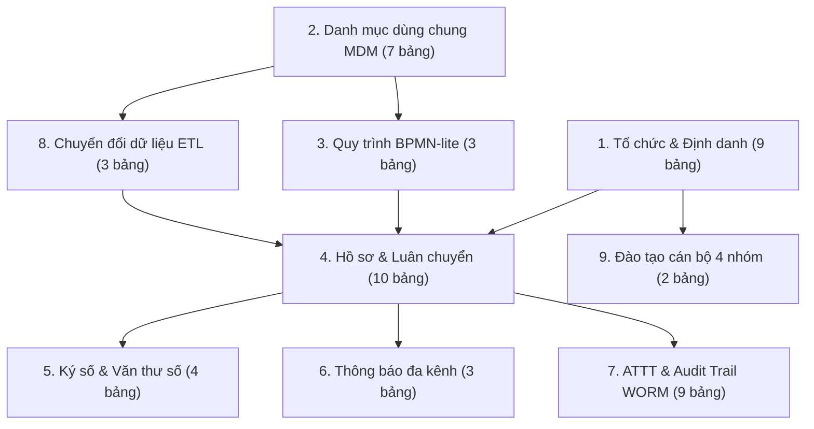
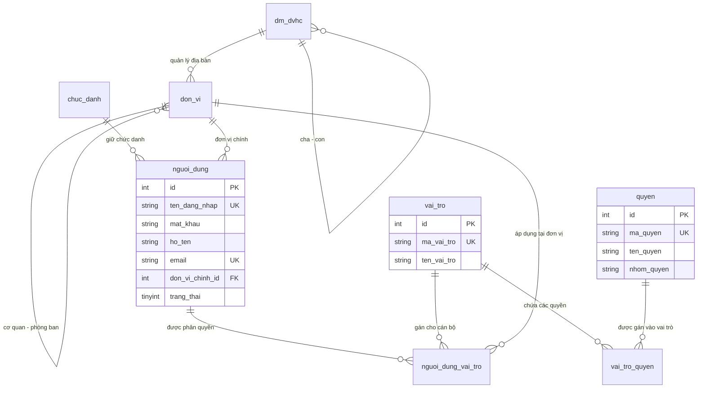
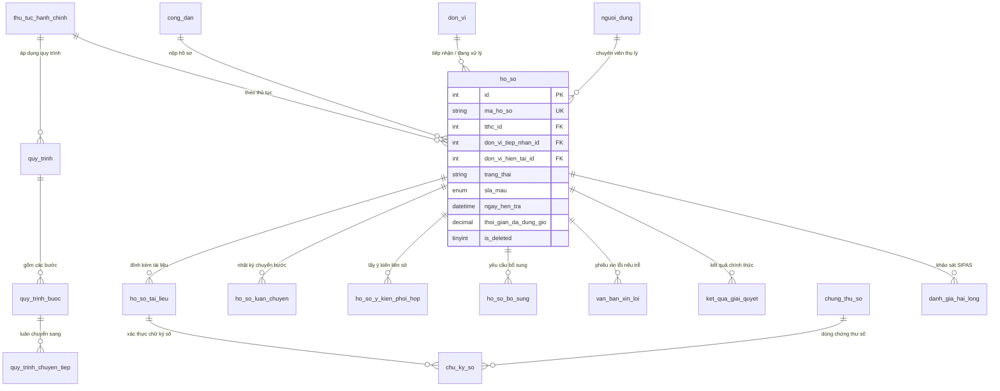

# TÀI LIỆU THIẾT KẾ CƠ SỞ DỮ LIỆU HP-eGov
## HỆ THỐNG THÔNG TIN QUẢN LÝ HÀNH CHÍNH & MỘT CỬA ĐIỆN TỬ LIÊN THÔNG TP. HẢI PHÒNG

> **Căn cứ tài liệu gốc:** `Báo cáo Kiến trúc & Kế hoạch Triển khai HP-eGov.pdf` (17 trang)  
> **Cơ sở dữ liệu:** MariaDB 10.4+ / MySQL 8.0+ (Quản trị trực quan qua phpMyAdmin trên XAMPP)  
> **Database Name:** `hp_egov` · **Charset:** `utf8mb4` · **Collation:** `utf8mb4_unicode_ci`  
> **Storage Engine:** `InnoDB` (Hỗ trợ toàn diện Giao dịch ACID và Ràng buộc Khóa ngoại)  
> **Phiên bản tài liệu:** v1.0.0 – Phiên 2 (Cơ sở dữ liệu & Dữ liệu mẫu)  

---

## MỤC LỤC
1. [Tổng quan kiến trúc Cơ sở dữ liệu](#1-tổng-quan-kiến-trúc-cơ-sở-dữ-liệu)
2. [Sơ đồ thực thể liên kết (ERD) chi tiết](#2-sơ-đồ-thực-thể-liên-kết-erd-chi-tiết)
3. [Từ điển dữ liệu toàn diện (Data Dictionary)](#3-từ-điển-dữ-liệu-toàn-diện-data-dictionary)
4. [Cơ chế Trigger bảo vệ nguyên tắc bất biến dữ liệu (§4.1)](#4-cơ-chế-trigger-bảo-vệ-nguyên-tắc-bất-biến-dữ-liệu-41)
5. [Hệ thống Views phục vụ Báo cáo & Dashboard IOC (§4.3)](#5-hệ-thống-views-phục-vụ-báo-cáo--dashboard-ioc-43)
6. [Chiến lược lập chỉ mục (Indexing Strategy) & Tối ưu hiệu năng](#6-chiến-lược-lập-chỉ-mục-indexing-strategy--tối-ưu-hiệu-năng)
7. [Hướng dẫn cài đặt & Kiểm thử trên phpMyAdmin](#7-hướng-dẫn-cài-đặt--kiểm-thử-trên-phpmyadmin)

---

## 1. TỔNG QUAN KIẾN TRÚC CƠ SỞ DỮ LIỆU

Hệ thống CSDL `hp_egov` được thiết kế chuẩn hóa bậc 3 (3NF), gồm **50 bảng vật lý**, **6 triggers bảo mật** và **3 views báo cáo tổng hợp**. CSDL được tổ chức thành 9 phân nhóm logic tương ứng với 15 phân hệ chức năng:



---

## 2. SƠ ĐỒ THỰC THỂ LIÊN KẾT (ERD) CHI TIẾT

### 2.1. ERD Nhóm Tổ chức, Người dùng & Phân quyền RBAC đa cấp (§4.1)


### 2.2. ERD Nhóm Nghiệp vụ Luân chuyển Hồ sơ, Ký số & SLA (§2.1, §2.2)


---

## 3. TỪ ĐIỂN DỮ LIỆU TOÀN DIỆN (DATA DICTIONARY)

### 3.1. Nhóm 1: Tổ chức, Định danh & RBAC
1. **`dm_dvhc` (Danh mục Đơn vị hành chính):**
   - `id` (INT PK AI): Khóa chính tự tăng.
   - `ma_dvhc` (VARCHAR(10) UNIQUE): Mã chuẩn Tổng cục Thống kê (ví dụ: `31` Hải Phòng, `303` Q. Hồng Bàng, `311` TP. Thủy Nguyên).
   - `ten_dvhc` (VARCHAR(150)): Tên đơn vị hành chính.
   - `cap_dvhc` (ENUM('TINH', 'HUYEN', 'XA')): Cấp quản lý hành chính.
   - `loai_dvhc` (ENUM('THANH_PHO', 'QUAN', 'HUYEN', 'PHUONG', 'XA', 'THI_TRAN')).
   - `parent_id` (INT NULL FK `dm_dvhc.id`): Đơn vị hành chính cấp trên trực tiếp.
   - `hieu_luc_tu` (DATE): Thời điểm bắt đầu có hiệu lực pháp lý.
   - `hieu_luc_den` (DATE NULL): Thời điểm hết hiệu lực (hỗ trợ chuyển đổi sang mô hình chính quyền đô thị 2 cấp mà không xóa đè dữ liệu cũ).
   - `trang_thai` (TINYINT): 1 = Đang áp dụng, 0 = Ngừng áp dụng.

2. **`don_vi` (Cơ quan, Đơn vị, Phòng ban & Bộ phận Một cửa):**
   - `id` (INT PK AI): Khóa chính tự tăng.
   - `ma_dinh_danh` (VARCHAR(50) UNIQUE): Mã định danh chuẩn QCVN 102:2016/BTTTT (ví dụ: `000.04.15.H21`).
   - `ten_don_vi` (VARCHAR(255)): Tên chính thức của cơ quan hoặc phòng ban.
   - `ten_viet_tat` (VARCHAR(50)): Ký hiệu viết tắt.
   - `loai_don_vi` (ENUM('UBND_TP', 'SO_NGANH', 'UBND_HUYEN', 'UBND_XA', 'PHONG_BAN', 'BO_PHAN_MOT_CUA')).
   - `parent_id` (INT NULL FK `don_vi.id`): Đơn vị cha trong cây tổ chức.
   - `dvhc_id` (INT NULL FK `dm_dvhc.id`): Liên kết địa bàn hành chính quản lý.
   - `path` (VARCHAR(255)): Materialized path (ví dụ: `/1/10/30/`) hỗ trợ truy vấn lọc phân quyền cây tổ chức cực nhanh.
   - `cap_do` (INT): Cấp độ phân cấp trong cây tổ chức (1 = Thành phố, 2 = Sở/Quận, 3 = Phòng/Một cửa).
   - `dia_chi`, `dien_thoai`, `email`: Thông tin liên hệ công vụ.

3. **`nguoi_dung` (Cán bộ, Công chức):**
   - `id` (INT PK AI): Khóa chính tự tăng.
   - `ten_dang_nhap` (VARCHAR(50) UNIQUE): Tên tài khoản nội bộ.
   - `mat_khau` (VARCHAR(255)): Mã băm Bcrypt (cost 12) an toàn.
   - `ho_ten`, `email` (UNIQUE), `so_dien_thoai`, `so_cccd`.
   - `chuc_danh_id` (INT NULL FK `chuc_danh.id`).
   - `don_vi_chinh_id` (INT FK `don_vi.id`): Đơn vị công tác chính.
   - `so_lan_sai` (INT DEFAULT 0): Đếm số lần đăng nhập sai (phục vụ chống brute-force).
   - `khoa_den` (DATETIME NULL): Thời điểm tạm khóa tài khoản khi nhập sai quá 5 lần.
   - `yeu_cau_doi_mk` (TINYINT DEFAULT 0): Buộc đổi mật khẩu trong phiên đầu tiên.
   - `is_deleted` (TINYINT DEFAULT 0): Khóa logic tài khoản (không xóa vật lý).

4. **`cong_dan` (Công dân & Doanh nghiệp nộp TTHC):**
   - `id` (INT PK AI): Khóa chính tự tăng.
   - `loai_chu_the` (ENUM('CA_NHAN', 'TO_CHUC')).
   - `so_cccd` (VARCHAR(20) UNIQUE NULL): Số định danh công dân trích xuất từ VNeID mức 2.
   - `ma_so_thue` (VARCHAR(20) UNIQUE NULL): Mã số thuế đối với doanh nghiệp.
   - `vneid_sub` (VARCHAR(100) UNIQUE NULL): Khóa định danh liên kết OIDC với VNeID.
   - `ho_ten`, `ngay_sinh`, `gioi_tinh`, `que_quan`, `dia_chi_thuong_tru`, `dia_chi_hien_tai`.
   - `ten_doanh_nghiep`, `nguoi_dai_dien`: Thông tin pháp nhân nếu là doanh nghiệp.

5. **`vai_tro`, `quyen`, `vai_tro_quyen`, `nguoi_dung_vai_tro`:**
   - Quản trị ma trận phân quyền 7 vai trò chuẩn và 34 quyền thao tác chi tiết. Bảng `nguoi_dung_vai_tro` liên kết `(nguoi_dung_id, vai_tro_id, don_vi_id)` cho phép một cán bộ kiêm nhiệm vai trò khác nhau tại các cơ quan khác nhau.

---

### 3.2. Nhóm 2: Danh mục Dùng chung (MDM)
6. **`thu_tuc_hanh_chinh` (Thủ tục hành chính):**
   - `id` (INT PK AI).
   - `ma_tthc` (VARCHAR(50) UNIQUE): Mã TTHC quốc gia theo CSDL TTHC (ví dụ: `1.000456.000.00.00.H21`).
   - `ma_rut_gon` (VARCHAR(4)): Mã 4 số dùng sinh mã hồ sơ QCVN 102 (ví dụ: `0042`).
   - `ten_tthc` (VARCHAR(255)): Tên thủ tục.
   - `cap_thuc_hien` (ENUM('TINH', 'HUYEN', 'XA')).
   - `muc_do_dvc` (ENUM('MOT_PHAN', 'TOAN_TRINH')).
   - `thoi_han_giai_quyet_ngay` (INT): Số ngày làm việc quy định.
   - `thoi_han_giai_quyet_gio` (INT): Quy đổi sang số giờ làm việc ($T = \text{ngày} \times 8\text{h}$).
   - `phi_le_phi` (DECIMAL(15,2)): Lệ phí quy định (VND).
   - `can_cu_phap_ly` (TEXT): Danh sách văn bản pháp luật căn cứ.
   - `trang_thai_cong_bo` (ENUM('CONG_BO', 'SUA_DOI', 'BAI_BO')).
   - `ngay_dong_bo` (DATETIME NULL): Thời điểm đồng bộ từ CSDL Quốc gia.

7. **`bieu_mau_eform` (Cấu trúc tờ khai điện tử JSON):**
   - `tthc_id` (INT UNIQUE FK `thu_tuc_hanh_chinh.id`).
   - `cau_truc_json` (LONGTEXT): Mô tả schema form nộp trực tuyến, định nghĩa các trường tự động điền (Auto-fill) từ VNeID (`vneid_field: 'so_cccd'`, `vneid_field: 'ho_ten'`).

8. **`dm_ngay_nghi` (Lịch nghỉ lễ tính SLA):**
   - `ngay` (DATE UNIQUE): Ngày dương lịch nghỉ lễ theo Bộ luật Lao động. Động cơ `SlaEngine` đọc bảng này để trừ ngày nghỉ khi tính toán thời hạn.

9. **`cau_hinh_he_thong` (Tham số hệ thống):**
   - `khoa` (VARCHAR(100) UNIQUE), `gia_tri` (TEXT), `kieu_du_lieu`, `nhom`. Lưu trữ giờ làm việc (07:30–11:30, 13:30–17:30), ngưỡng cảnh báo SLA (75%, 24h), mã tỉnh `H21`.

---

### 3.3. Nhóm 3: Quy trình Luân chuyển (BPMN-lite)
10. **`quy_trinh`, `quy_trinh_buoc`, `quy_trinh_chuyen_tiep`:**
    - Cho phép cấu hình quy trình động theo từng TTHC.
    - Cột `don_vi_xu_ly_id` tại `quy_trinh_buoc` cho phép một bước chuyển sang đơn vị khác (liên thông ngang giữa các Sở Xây dựng, TN&MT, KH&ĐT; liên thông dọc từ Quận lên UBND Thành phố).
    - Cột `thoi_han_gio` ấn định thời gian tối đa cho từng bước. Tổng thời hạn các bước bảo đảm khớp với tổng thời hạn TTHC.

---

### 3.4. Nhóm 4: Hồ sơ TTHC & Vòng đời Nghiệp vụ (§2.1, §2.2)
11. **`bo_dem_ma_ho_so` (Cấp mã hồ sơ QCVN 102 không trùng lặp):**
    - Khóa chính kết hợp `(don_vi_id, nam)`. Cấp mã thông qua câu lệnh `SELECT so_hien_tai FROM bo_dem_ma_ho_so WHERE don_vi_id = ? AND nam = ? FOR UPDATE`.
    - Sinh mã chuẩn: `{MaDinhDanhDonVi}-{yyMMdd}-{MaTTHC4}-{STT6}` (ví dụ: `000.04.15.H21-260115-0042-000123`).

12. **`ho_so` (Bảng Hồ sơ cốt lõi):**
    - `ma_ho_so` (VARCHAR(60) UNIQUE).
    - `don_vi_tiep_nhan_id` (INT FK `don_vi.id`): Nơi phát sinh tiếp nhận ban đầu.
    - `don_vi_hien_tai_id` (INT FK `don_vi.id`): Đơn vị hiện tại đang giữ hồ sơ (phục vụ liên thông đa cơ quan).
    - `chuyen_vien_thu_ly_id` (INT NULL FK `nguoi_dung.id`): Cán bộ thụ lý chính.
    - `trang_thai` (VARCHAR(50)): Thuộc Enum `TrangThaiHoSo` (`CHO_TIEP_NHAN`, `MOI_TIEP_NHAN`, `DANG_XU_LY`, `CHO_BO_SUNG`, `CHO_PHE_DUYET`, `HOAN_THANH`, `DA_TRA_KET_QUA`, `TU_CHOI`, `DA_HUY`).
    - `sla_mau` (ENUM('XANH', 'VANG', 'DO')): Trạng thái cảnh báo tiến độ thời gian thực.
    - `tong_thoi_han_gio` (INT): Tổng thời hạn giải quyết.
    - `thoi_gian_da_dung_gio` (DECIMAL(8,2)): Số giờ làm việc thực tế đã dùng.
    - `so_gio_tam_dung` (DECIMAL(8,2)): Thời gian đóng băng khi chờ công dân nộp bổ sung.
    - `ngay_nop`, `ngay_tiep_nhan`, `ngay_hen_tra`, `ngay_hoan_thanh`, `ngay_tra_ket_qua`.
    - `is_deleted` (TINYINT DEFAULT 0): Nguyên tắc bất biến – 1 là hủy logic.
    - `can_cu_huy`, `bien_ban_giai_trinh`, `nguoi_duyet_huy_id`: Bắt buộc điền khi hủy logic.

13. **`ho_so_tai_lieu` (Tài liệu đính kèm & Số hóa NĐ 107/2021/NĐ-CP):**
    - `ten_goc` (VARCHAR(255)): Tên file nguyên bản.
    - `ten_luu` (VARCHAR(255) UNIQUE): Tên file mã hóa UUIDv4 lưu trong `storage/uploads/`.
    - `sha256` (VARCHAR(64)): Checksum SHA-256 đối soát tính toàn vẹn và chống giả mạo qua các trạm trung chuyển dữ liệu.
    - `loai_tai_lieu` (ENUM('DAU_VAO', 'SO_HOA', 'DU_THAO', 'KET_QUA', 'BO_SUNG')).
    - `so_hoa_boi_id` (INT NULL FK `nguoi_dung.id`), `ngay_so_hoa` (DATETIME NULL).

14. **`van_ban_xin_loi` (Phiếu xin lỗi Mẫu số 04 theo Thông tư 01/2018/TT-VPCP):**
    - `ho_so_id` (INT UNIQUE FK `ho_so.id`): Mỗi hồ sơ quá hạn gắn với 1 văn bản xin lỗi.
    - `so_van_ban`, `nguoi_ky_id` (Lãnh đạo cơ quan), `ly_do_qua_han`, `ngay_hen_moi`, `ngay_ky`.
    - *Ràng buộc nghiệp vụ:* Hệ thống khóa chuyển bước của chuyên viên khi hồ sơ chuyển sang màu Đỏ cho đến khi Lãnh đạo ký văn bản xin lỗi này.

15. **`danh_gia_hai_long` (Khảo sát sự hài lòng SIPAS):**
    - Đo lường 5 tiêu chí thang điểm 1–5: Tiếp cận dịch vụ, Tính minh bạch của thủ tục, Thái độ công chức, Chất lượng kết quả, Tiếp nhận phản ánh kiến nghị.

---

### 3.5. Nhóm 5: Ký số Điện tử & Văn thư số (§1.4, §2.1)
16. **`chung_thu_so` & `chu_ky_so`:**
    - `chung_thu_so`: Quản lý chứng thư cá nhân của cán bộ (SmartCA / USB Token) và chứng thư tổ chức (con dấu số cơ quan).
    - `chu_ky_so`: Lưu trữ băm trước khi ký (`sha256_truoc_ky`), chuỗi chữ ký số (`chu_ky_binary_base64`) và kết quả xác thực.

17. **`so_van_ban` & `van_ban_den_di`:**
    - Quản lý sổ văn bản đi/đến điện tử của Văn thư số, cấp số công văn tăng dần tự động và lưu vết ngày vào sổ.

---

### 3.6. Nhóm 6: Truyền thông & Thông báo Đa kênh (§2.2)
18. **`hang_doi_thong_bao` (Outbox Pattern):**
    - Quản lý hàng đợi gửi SMS Brandname "UBND TP HP" và tin Zalo ZNS (Trung tâm Thông tin và Dịch vụ hành chính công Hải Phòng).
    - Có cơ chế đếm số lần thử lại (`so_lan_thu`) và lưu phản hồi của cổng gửi tin.

---

### 3.7. Nhóm 7: An toàn Thông tin & Kiểm toán WORM (§3.3, §4.3)
19. **`nhat_ky_kiem_toan` (Audit Trail WORM dạng Hash Chain):**
    - Mỗi bản ghi lưu: `hanh_dong`, `bang_tac_dong`, `ban_ghi_id`, `du_lieu_cu`, `du_lieu_moi`, `dia_chi_ip`, `user_agent`.
    - Thuật toán chuỗi băm bất biến:
      $$H_n = \text{SHA256}(H_{n-1} \parallel \text{Data}_n)$$
    - Cho phép công cụ kiểm toán quét toàn bộ lịch sử để phát hiện tức thời bất kỳ can thiệp trực tiếp nào vào CSDL.

20. **`sao_luu` (Quản lý sao lưu RPO $\le$ 2h, RTO $\le$ 4h):**
    - Theo dõi lịch sử sao lưu Full (Chủ nhật), Differential (hằng đêm), Transaction Log (2 giờ/lần) và checksum SHA-256 của file sao lưu.

21. **`su_co` & `dien_tap`:**
    - Nhật ký sự cố hạ tầng/an ninh mạng (đứt TSLCD, DDoS...) phân định theo RACI Sở TT&TT vs Đơn vị nghiệp vụ; theo dõi lịch diễn tập an toàn thông tin 6 tháng/lần và diễn tập phục hồi thảm họa DRP 12 tháng/lần.

---

### 3.8. Nhóm 8 & 9: ETL & Quản lý Đào tạo (§1.3.A, §1.4)
22. **`etl_lo`, `etl_staging_ho_so`, `etl_loi`:**
    - Quản lý tiến trình nạp dữ liệu Một cửa cũ (5 năm lịch sử), kiểm tra hồ sơ rác, thiếu CCCD và ánh xạ danh mục.
23. **`dao_tao_khoa`, `dao_tao_hoc_vien`:**
    - Theo dõi sát hạch năng lực 4 nhóm đối tượng: Một cửa ($\ge 90/100$ điểm), Chuyên viên (xử lý 10 hồ sơ mẫu không lỗi), Lãnh đạo (ký số thành công), SysAdmin (khôi phục trong $RTO < 4\text{h}$).

---

## 4. CƠ CHẾ TRIGGER BẢO VỆ NGUYÊN TẮC BẤT BIẾN DỮ LIỆU (§4.1)

Hệ thống đã nạp sẵn 6 Trigger cấp CSDL để ngăn chặn triệt để các hành vi phá hoại hoặc xóa nhầm dữ liệu:

| Tên Trigger | Bảng tác động | Sự kiện | Hành vi xử lý |
|---|---|---|---|
| `tg_hoso_prevent_delete` | `ho_so` | `BEFORE DELETE` | **Chặn lệnh DELETE**, trả lỗi `SQLSTATE '45000'`: Nghiêm cấm xóa vật lý hồ sơ hành chính. |
| `tg_tailieu_prevent_delete` | `ho_so_tai_lieu` | `BEFORE DELETE` | **Chặn lệnh DELETE**, trả lỗi `SQLSTATE '45000'`: Nghiêm cấm xóa vật lý tài liệu đính kèm. |
| `tg_luanchuyen_prevent_delete` | `ho_so_luan_chuyen` | `BEFORE DELETE` | **Chặn lệnh DELETE**, trả lỗi `SQLSTATE '45000'`: Không được phép xóa lịch sử luân chuyển. |
| `tg_kyso_prevent_delete` | `chu_ky_so` | `BEFORE DELETE` | **Chặn lệnh DELETE**, trả lỗi `SQLSTATE '45000'`: Chữ ký số là chứng thư pháp lý bất biến. |
| `tg_audit_prevent_update` | `nhat_ky_kiem_toan` | `BEFORE UPDATE` | **Chặn lệnh UPDATE**, bảo đảm tính chất WORM bất biến (Append-only). |
| `tg_audit_prevent_delete` | `nhat_ky_kiem_toan` | `BEFORE DELETE` | **Chặn lệnh DELETE**, bảo đảm tính chất WORM bất biến. |

---

## 5. HỆ THỐNG VIEWS PHỤC VỤ BÁO CÁO & DASHBOARD IOC (§4.3)

### 5.1. View `v_ho_so_tong_hop`
Quy đổi toàn bộ trạng thái chi tiết của hồ sơ về **6 nhóm trạng thái chuẩn theo Thông tư 01/2018/TT-VPCP** phục vụ báo cáo hành chính:
- `CHO_TIEP_NHAN` & `MOI_TIEP_NHAN` $\longrightarrow$ `MOI_TIEP_NHAN`
- `DANG_XU_LY` $\longrightarrow$ `DANG_XU_LY`
- `CHO_BO_SUNG` $\longrightarrow$ `CHO_BO_SUNG`
- `CHO_PHE_DUYET` $\longrightarrow$ `CHO_PHE_DUYET`
- `HOAN_THANH` & `TU_CHOI` $\longrightarrow$ `HOAN_THANH`
- `DA_TRA_KET_QUA` $\longrightarrow$ `DA_TRA_KET_QUA`

### 5.2. View `v_ty_le_dung_han_don_vi`
Tính toán tức thời các chỉ số KPI theo từng đơn vị:
- Tổng số hồ sơ tiếp nhận
- Tỷ lệ hồ sơ trực tuyến ($\%$)
- Tỷ lệ hồ sơ giải quyết đúng hạn ($\%$) đối chiếu với chỉ tiêu vàng $\ge 98\%$
- Số hồ sơ đang quá hạn (cần chỉ đạo xử lý)

### 5.3. View `v_ho_so_qua_han`
Lọc danh sách các hồ sơ đang trong vùng cảnh báo Đỏ ($t > T$), tính toán số giờ trễ hạn thực tế và kiểm tra xem hồ sơ đã được Lãnh đạo ký ban hành Văn bản xin lỗi Mẫu số 04 hay chưa.

---

## 6. CHIẾN LƯỢC LẬP CHỈ MỤC (INDEXING STRATEGY) & TỐI ƯU HIỆU NĂNG

Để đáp ứng tiêu chuẩn kiểm thử tải 5.000 CCU công dân và 1.200 CCU cán bộ với thời gian phản hồi $\le 1.0\text{ giây}$ (§3.2 Báo cáo), CSDL áp dụng các nguyên tắc tối ưu sau:

1. **Chỉ mục tìm kiếm thường xuyên:**
   - Đánh index trên `ma_ho_so`, `so_cccd`, `ma_so_thue`, `sha256` tệp tin.
2. **Chỉ mục hỗ trợ lọc danh sách & phân trang:**
   - `idx_hs_donvi_tn` (`don_vi_tiep_nhan_id`)
   - `idx_hs_donvi_ht` (`don_vi_hien_tai_id`)
   - `idx_hs_chuyenvien` (`chuyen_vien_thu_ly_id`)
   - `idx_hs_trangthai` (`trang_thai`)
   - `idx_hs_sla` (`sla_mau`)
   - `idx_hs_ngay_nop` (`ngay_nop`)
3. **Chỉ mục kiểm soát phân quyền cây tổ chức (Materialized Path):**
   - Đánh index trên cột `path` của bảng `don_vi` hỗ trợ truy vấn con: `WHERE path LIKE '/1/10/%'`.
4. **Kiến trúc tách kết nối Đọc / Ghi (Read/Write Splitting):**
   - Lớp lõi `Database.php` cấu hình tách luồng: các câu lệnh `INSERT`, `UPDATE` gửi đến Master DB; các câu lệnh `SELECT` phục vụ Dashboard/Báo cáo gửi đến Slave Replica để giảm tải cho máy chủ giao dịch chính.

---

## 7. HƯỚNG DẪN CÀI ĐẶT & KIỂM THỬ TRÊN PHPMYADMIN

### 7.1. Cài đặt trực tiếp qua phpMyAdmin
1. Mở trình duyệt truy cập: `http://localhost/phpmyadmin/`.
2. Chọn tab **Import (Nhập)**.
3. Chọn tệp `database/schema.sql` $\longrightarrow$ Bấm **Import** để khởi tạo 50 bảng, 6 triggers và 3 views.
4. Tiếp tục chọn tệp `database/seed.sql` $\longrightarrow$ Bấm **Import** để nạp dữ liệu mẫu thực tế của TP. Hải Phòng (15 quận/huyện, các sở ban ngành, tài khoản mẫu và 205 bộ hồ sơ mẫu).

### 7.2. Cài đặt qua giao diện dòng lệnh (CLI)
```powershell
# Import Schema
C:\xampp\mysql\bin\mysql.exe -u root -e "source c:/xampp/htdocs/HP-eGov/database/schema.sql"

# Import Seed Data
C:\xampp\mysql\bin\mysql.exe -u root -e "source c:/xampp/htdocs/HP-eGov/database/seed.sql"
```

### 7.3. Kiểm chứng kết quả cài đặt
Chạy truy vấn kiểm chứng số liệu:
```sql
USE `hp_egov`;

-- 1. Kiểm tra số lượng hồ sơ theo màu SLA
SELECT 
    COUNT(*) AS tong_ho_so,
    SUM(CASE WHEN sla_mau = 'XANH' THEN 1 ELSE 0 END) AS so_xanh,
    SUM(CASE WHEN sla_mau = 'VANG' THEN 1 ELSE 0 END) AS so_vang,
    SUM(CASE WHEN sla_mau = 'DO' THEN 1 ELSE 0 END) AS so_do
FROM ho_so;

-- 2. Kiểm tra tỷ lệ đúng hạn của các Sở / Quận trên View
SELECT ten_don_vi, tong_ho_so_tiep_nhan, ty_le_truc_tuyen_pt, ty_le_dung_han_pt 
FROM v_ty_le_dung_han_don_vi 
WHERE tong_ho_so_tiep_nhan > 0;

-- 3. Kiểm chứng Trigger chặn xóa vật lý
DELETE FROM ho_so WHERE id = 1;
-- Kết quả trả về mong đợi: ERROR 1644 (45000): LỖI BẢO MẬT: Nghiêm cấm xóa vật lý hồ sơ hành chính!
```
