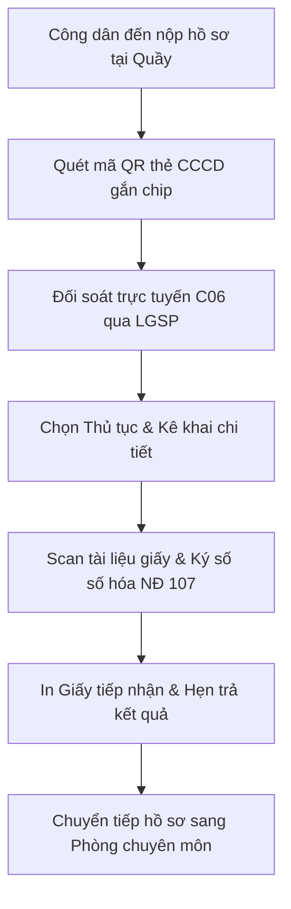

# TÀI LIỆU HƯỚNG DẪN SỬ DỤNG HỆ THỐNG HP-eGov
## DÀNH CHO: CÁN BỘ TIẾP NHẬN & TRẢ KẾT QUẢ MỘT CỬA (CB_MOT_CUA)
**Tài khoản mẫu:** `motcua.hongbang` | **Mật khẩu:** `Hpegov@2026`  
**Phiên bản:** v1.0.0 | **Ngày ban hành:** Tháng 10/2026

---

### I. MỤC TIÊU & NHIỆM VỤ CỦA CÁN BỘ MỘT CỬA
Cán bộ Một cửa chịu trách nhiệm tại Bộ phận Tiếp nhận và Trả kết quả cấp Xã/Phường, Quận/Huyện và Sở ban ngành:
1. Tiếp nhận hồ sơ trực tiếp của công dân đến trụ sở.
2. Quét mã QR thẻ CCCD gắn chip tự động bóc tách thông tin và đối soát với CSDL Quốc gia về Dân cư (C06) qua trục LGSP Hải Phòng.
3. Số hóa hồ sơ đầu vào theo Nghị định 107/2021/NĐ-CP và ký số xác thực tài liệu scan bằng OpenSSL PKI.
4. Sinh mã hồ sơ duy nhất chuẩn QCVN 102 và in Giấy tiếp nhận hồ sơ & hẹn trả kết quả (Mẫu số 01).
5. Luân chuyển hồ sơ sang phòng chuyên môn (Chuyên viên thụ lý) trên hệ thống.
6. Trả kết quả giải quyết TTHC cho công dân tại quầy hoặc bàn giao Bưu điện VNPost.

---

### II. QUY TRÌNH NGHIỆP VỤ TIẾP NHẬN MỘT CỬA

---

### III. HƯỚNG DẪN THAO TÁC CHI TIẾT

#### 1. Đăng nhập hệ thống cán bộ
- Truy cập địa chỉ: `http://localhost/HP-eGov/admin/dang-nhap`.
- Nhập tên đăng nhập: `motcua.hongbang` | Mật khẩu: `Hpegov@2026`.
- Hệ thống điều hướng vào Dashboard Một cửa với các bảng thống kê: Hồ sơ chờ tiếp nhận, Hồ sơ đang xử lý, Hồ sơ sắp đến hạn.

#### 2. Tiếp nhận hồ sơ trực tiếp & Quét mã QR CCCD
1. Vào menu **"Bộ phận Một cửa"** $\rightarrow$ **"Tiếp nhận hồ sơ"** (`/admin/mot-cua/tiep-nhan`).
2. **Quét mã QR thẻ CCCD gắn chip:**
   - *Cách 1:* Nhấn **"📸 Bật Camera quét thẻ CCCD"** và đưa mặt sau thẻ CCCD trước ống kính.
   - *Cách 2:* Dùng máy quét mã vạch (súng barcode 2D) quét vào ô "Dán chuỗi quét QR" và nhấn **"⚡ Phân tích & Tự điền"**.
   - Hệ thống tự động bóc tách: Số CCCD, Họ tên, Ngày sinh, Giới tính, Địa chỉ thường trú.
3. **Đối soát danh tính C06:**
   - Hệ thống tự động kết nối qua trục LGSP Hải Phòng đối soát với CSDLQG về Dân cư.
   - Khi thông tin trùng khớp, hộp trạng thái chuyển màu xanh: `✔ ĐỐI SOÁT C06 THÀNH CÔNG (Mã LGSP: LGSP-C06-xxxxxx)`.
4. **Chọn thủ tục & nạp tài liệu:**
   - Chọn Thủ tục hành chính yêu cầu (ví dụ: *Cấp giấy phép xây dựng nhà ở riêng lẻ*).
   - Tải lên các file tài liệu đã scan.

#### 3. Số hóa hồ sơ đầu vào (Nghị định 107/2021/NĐ-CP)
- Tại bảng thành phần hồ sơ, nhấn nút **"Số hóa & Ký số"** bên cạnh tệp tin.
- Hệ thống sử dụng chứng thư số cá nhân của Cán bộ Một cửa ký số số hóa (`SO_HOA`), tính mã băm SHA-256 lưu vào bảng `chu_ky_so`, đồng thời gắn con dấu điện tử số hóa xác thực tính pháp lý của tài liệu.

#### 4. Cấp mã QCVN 102 & In Giấy tiếp nhận hẹn trả kết quả
1. Nhấn nút **"Hoàn tất Tiếp nhận & Sinh mã"**.
2. Hệ thống tạo mã hồ sơ theo cú pháp chuẩn: `{MaDonVi}-{yyMMdd}-{MaTTHC}-{STT}`.
3. Nhấn nút **"🖨️ In Giấy tiếp nhận & Hẹn trả"** (`/admin/mot-cua/in-giay-hen/{id}`).
4. Màn hình in mở ra mẫu Giấy hẹn chuẩn Thông tư 01/2018/TT-VPCP có mã vạch barcode và **Mã QR tra cứu tiến độ** để bàn giao cho công dân.

#### 5. Chuyển hồ sơ sang Phòng chuyên môn
- Tại màn hình chi tiết hồ sơ, nhấn **"Chuyển phòng chuyên môn"**.
- Chọn Chuyên viên hoặc Phòng ban thụ lý, nhập nội dung ý kiến chuyển giao và nhấn **"Xác nhận chuyển"**.
