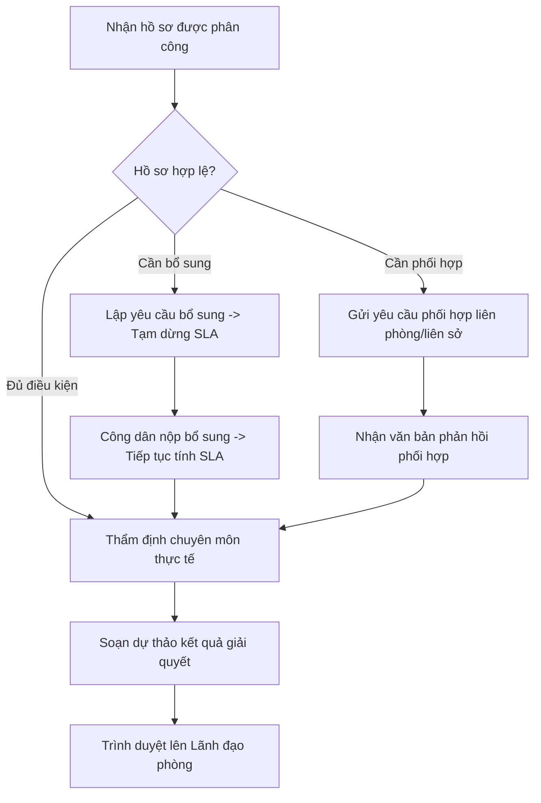

# TÀI LIỆU HƯỚNG DẪN SỬ DỤNG HỆ THỐNG HP-eGov
## DÀNH CHO: CHUYÊN VIÊN PHÒNG CHUYÊN MÔN THỤ LÝ (CHUYEN_VIEN)
**Tài khoản mẫu:** `chuyenvien.hongbang` | **Mật khẩu:** `Hpegov@2026`  
**Phiên bản:** v1.0.0 | **Ngày ban hành:** Tháng 10/2026

---

### I. MỤC TIÊU & NHIỆM VỤ CỦA CHUYÊN VIÊN THỤ LÝ
Chuyên viên thuộc các phòng chuyên môn (Phòng TN&MT, Phòng QLĐT, Phòng Tư pháp, các Phòng chuyên ngành thuộc Sở) có nhiệm vụ:
1. Tiếp nhận hồ sơ được phân công từ Lãnh đạo phòng hoặc Cán bộ Một cửa.
2. Thẩm tra, thẩm định chuyên môn tính hợp lệ, đầy đủ của hồ sơ và thực địa.
3. Kiểm soát đồng hồ SLA thời gian thực: Ưu tiên xử lý hồ sơ có cảnh báo màu Vàng hoặc Đỏ.
4. Gửi yêu cầu lấy ý kiến phối hợp liên phòng / liên sở (Liên thông ngang).
5. Yêu cầu công dân bổ sung hồ sơ nếu còn thiếu sót (kích hoạt tạm dừng tính thời gian SLA).
6. Lập dự thảo kết quả giải quyết (Giấy phép, Quyết định, Giấy chứng nhận) và trình duyệt lên Lãnh đạo phòng.

---

### II. QUY TRÌNH THỤ LÝ CHUYÊN MÔN

---

### III. HƯỚNG DẪN THAO TÁC CHI TIẾT

#### 1. Đăng nhập & Quản lý danh sách hồ sơ được phân công
1. Đăng nhập với tài khoản: `chuyenvien.hongbang` / `Hpegov@2026`.
2. Vào menu **"Thụ lý hồ sơ"** $\rightarrow$ **"Hồ sơ đang xử lý"** (`/admin/thu-ly`).
3. Màn hình danh sách hiển thị các cột:
   - **Mã hồ sơ & Tên thủ tục**
   - **Người nộp & Ngày tiếp nhận**
   - **Hạn cam kết trả kết quả**
   - **Chỉ báo SLA:** Huy hiệu màu **XANH** (Còn nhiều thời gian), **VÀNG** (Sắp đến hạn $\le 24$h), **ĐỎ** (Đã trễ hạn).
   - Chuyên viên cần lọc và xử lý các hồ sơ màu Vàng trước để ngăn ngừa phát sinh quá hạn.

#### 2. Kiểm tra tài liệu & Thẩm định chuyên môn
1. Nhấn vào hàng hồ sơ để mở màn hình **"Chi tiết thụ lý hồ sơ"**.
2. Xem thông tin biểu mẫu E-Form và mở các tệp tin đính kèm đã được Cán bộ Một cửa số hóa.
3. Kiểm tra tính toàn vẹn của tệp tin qua huy hiệu `✔ SHA-256 Hợp lệ`.

#### 3. Lấy ý kiến phối hợp liên phòng / liên sở (Liên thông ngang)
1. Trong màn hình chi tiết, chuyển sang tab **"Ý kiến phối hợp"**.
2. Nhấn nút **"Gửi yêu cầu phối hợp"**:
   - Chọn Đơn vị phối hợp (ví dụ: *Phòng Quản lý đô thị*, hoặc *Sở Tài nguyên và Môi trường*).
   - Nhập nội dung cần xin ý kiến chuyên môn (ví dụ: *Thẩm định quy hoạch cao độ và chỉ giới đường đỏ*).
   - Thiết lập hạn trả lời (mặc định 03 ngày làm việc).
   - Nhấn **"Gửi yêu cầu"**.
3. Hồ sơ tự động xuất hiện tại danh sách công việc của chuyên viên đơn vị phối hợp. Khi có phản hồi, hệ thống gửi thông báo In-app cho chuyên viên thụ lý chính.

#### 4. Yêu cầu sửa đổi, bổ sung hồ sơ (Tạm dừng SLA)
1. Nếu hồ sơ thiếu giấy tờ, nhấn nút **"Yêu cầu bổ sung hồ sơ"**.
2. Chọn các loại giấy tờ cần bổ sung, nêu rõ lý do theo quy định pháp luật và đặt hạn bổ sung (tối đa 30 ngày).
3. Nhấn **"Gửi yêu cầu bổ sung"**:
   - Hệ thống tự động chuyển trạng thái hồ sơ sang `CHO_BO_SUNG`.
   - Đồng hồ tính giờ SLA tự động **TẠM DỪNG** (ghi nhận số giờ tạm dừng, không bị tính vào thời gian trễ hạn của chuyên viên).
   - Tin nhắn thông báo SMS/Zalo tự động gửi đến điện thoại công dân.

#### 5. Soạn dự thảo kết quả & Trình duyệt
1. Sau khi hoàn tất thẩm định, chuyển sang tab **"Dự thảo kết quả"**.
2. Tải lên tệp dự thảo Giấy phép / Quyết định (định dạng PDF chuẩn).
3. Nhập ý kiến thẩm định chuyên môn vào ô ghi chú.
4. Nhấn nút **"Trình duyệt Lãnh đạo phòng"**. Hồ sơ lập tức chuyển sang hàng đợi duyệt của Lãnh đạo phòng.
