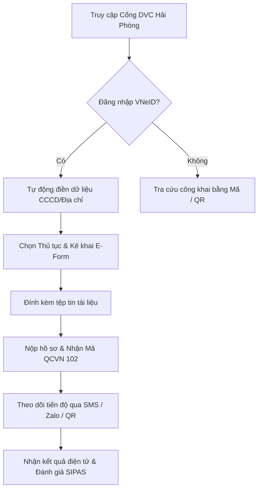

# TÀI LIỆU HƯỚNG DẪN SỬ DỤNG HỆ THỐNG HP-eGov
## DÀNH CHO: CÔNG DÂN VÀ DOANH NGHIỆP (CONG_DAN)
**Phiên bản:** v1.0.0 | **Ngày ban hành:** Tháng 10/2026

---

### I. MỤC TIÊU & PHẠM VI
Tài liệu hướng dẫn công dân và doanh nghiệp thực hiện các thủ tục hành chính trực tuyến trên Cổng Dịch vụ công TP. Hải Phòng (`http://localhost/HP-eGov/`):
- Đăng nhập qua VNeID Định danh điện tử Mức 2.
- Nộp hồ sơ dịch vụ công trực tuyến toàn trình / một phần.
- Tra cứu tiến độ hồ sơ qua mã định danh QCVN 102 và quét mã QR camera không cần đăng nhập.
- Khai thác Kho dữ liệu điện tử cá nhân để tái sử dụng giấy tờ đã số hóa.
- Đánh giá sự hài lòng về chất lượng phục vụ (Chỉ số SIPAS).

---

### II. QUY TRÌNH DÀNH CHO CÔNG DÂN

---

### III. HƯỚNG DẪN CHI TIẾT TỪNG BƯỚC

#### 1. Đăng nhập qua Cổng Định danh điện tử Quốc gia (VNeID)
1. Truy cập trang chủ Cổng DVC tại `http://localhost/HP-eGov/`.
2. Nhấn nút **"Đăng nhập VNeID"** ở góc phải thanh điều hướng.
3. Hệ thống chuyển hướng sang giao diện xác thực VNeID Mức 2 Sandbox. Nhập số CCCD (Ví dụ: `031095000123`) hoặc nhấn **"Đăng nhập tài khoản mẫu công dân"**.
4. Sau khi đăng nhập thành công, góc phải màn hình sẽ hiển thị họ tên công dân và số CCCD được bảo vệ.

#### 2. Nộp hồ sơ Dịch vụ công trực tuyến
1. Trên thanh điều hướng, chọn mục **"Dịch vụ công"** (`/dvc`).
2. Tìm kiếm thủ tục cần nộp (ví dụ: *Đăng ký biến động quyền sử dụng đất*, *Cấp giấy phép xây dựng*, *Cấp đổi Giấy phép lái xe*).
3. Nhấn nút **"Nộp hồ sơ trực tuyến"**:
   - **Bước 1 - Thông tin người nộp:** Hệ thống tự động điền toàn bộ Họ tên, Số CCCD, Địa chỉ thường trú từ tài khoản VNeID đã xác thực.
   - **Bước 2 - Biểu mẫu điện tử (E-Form):** Điền các trường thông tin đặc thù theo yêu cầu biểu mẫu JSON chuẩn.
   - **Bước 3 - Thành phần hồ sơ đính kèm:** Tải lên các tệp tin giấy tờ (PDF, JPG, PNG dung lượng $\le 20$MB). Nếu giấy tờ đã có trong Kho dữ liệu điện tử cá nhân, công dân chỉ cần nhấn **"Chọn từ Kho dữ liệu"** mà không cần tải lại.
   - **Bước 4 - Xác nhận & Nộp:** Kiểm tra lại toàn bộ thông tin và nhấn nút **"Gửi hồ sơ"**.
4. Hệ thống cấp ngay **Mã định danh hồ sơ chuẩn QCVN 102** (ví dụ: `000.04.15.H21-260405-0042-000001`) và hiển thị **Mã QR tra cứu tiến độ**.

#### 3. Tra cứu tiến độ hồ sơ & Quét mã QR Camera
- **Cách 1: Nhập mã hồ sơ:** Truy cập `/tra-cuu`, nhập mã hồ sơ và nhấn **"Tra cứu"**.
- **Cách 2: Quét mã QR bằng Camera:** Nhấn tab **"📷 Quét mã QR bằng Camera"**, đưa camera trước giấy hẹn hoặc mã QR nhận được trên điện thoại. Hệ thống tự động nhận diện và hiển thị trạng thái xử lý thời gian thực, cán bộ đang thụ lý, ngày hẹn trả kết quả và các mốc luân chuyển.

#### 4. Khai thác Kho Dữ liệu Điện tử Cá nhân
1. Vào menu **"Kho dữ liệu cá nhân"** (`/cong-dan/kho-du-lieu`).
2. Danh sách tất cả các giấy tờ đã được cơ quan nhà nước cấp bản điện tử hoặc số hóa có giá trị pháp lý (Giấy phép lái xe, Bản sao trích lục hộ tịch, Giấy chứng nhận QSDĐ điện tử).
3. Công dân có thể tải về bản PDF có chữ ký số cơ quan hoặc dùng để nộp các thủ tục hành chính kế tiếp mà không cần công chứng lại.

#### 5. Đánh giá sự hài lòng phục vụ (SIPAS)
- Sau khi hồ sơ hoàn thành và trả kết quả, hệ thống tự động gửi tin nhắn SMS / Zalo ZNS kèm liên kết đánh giá.
- Công dân truy cập liên kết và chấm điểm theo thang điểm 5 sao trên 5 tiêu chí: Tiếp cận dịch vụ, Tính đơn giản của thủ tục, Tinh thần thái độ công chức, Thời gian giải quyết, và Kênh tiếp nhận phản ánh.
