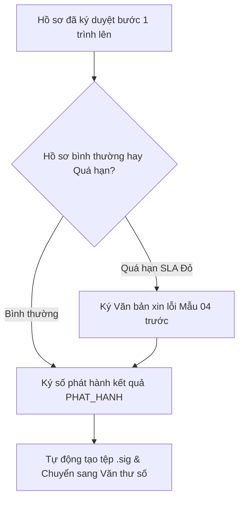

# TÀI LIỆU HƯỚNG DẪN SỬ DỤNG HỆ THỐNG HP-eGov
## DÀNH CHO: LÃNH ĐẠO CƠ QUAN UBND / SỞ BAN NGÀNH (LD_CO_QUAN)
**Tài khoản mẫu:** `ldcoquan.hongbang` | **Mật khẩu:** `Hpegov@2026`  
**Phiên bản:** v1.0.0 | **Ngày ban hành:** Tháng 10/2026

---

### I. MỤC TIÊU & NHIỆM VỤ CỦA LÃNH ĐẠO CƠ QUAN
Lãnh đạo cơ quan (Chủ tịch/Phó Chủ tịch UBND Quận/Huyện/Thành phố; Giám đốc/Phó Giám đốc Sở) giữ thẩm quyền cao nhất trong chu trình giải quyết TTHC:
1. Xem xét hồ sơ và dự thảo kết quả đã được Lãnh đạo phòng chuyên môn ký duyệt bước 1.
2. Thực hiện ký số phê duyệt phát hành kết quả (`PHAT_HANH`) bằng chứng thư số USB Token hoặc giải pháp Ký số từ xa qua thiết bị di động (VNPT/Viettel SmartCA Cloud PKI).
3. Hỗ trợ tính năng ký duyệt theo lô (Batch Signing) cho các thủ tục có khối lượng lớn.
4. Ký số ban hành Văn bản xin lỗi và hẹn lại ngày trả kết quả (Mẫu số 04 theo Thông tư 01/2018/TT-VPCP) đối với các hồ sơ bị trễ hạn SLA Đỏ.
5. Xem báo cáo Dashboard Chỉ đạo điều hành (IOC Hải Phòng) để nắm bắt tiến độ chung, tỷ lệ đúng hạn, điểm thi đua và xử lý các điểm nghẽn (bottleneck).

---

### II. QUY TRÌNH PHÊ DUYỆT & KÝ SỐ LÃNH ĐẠO

---

### III. HƯỚNG DẪN THAO TÁC CHI TIẾT

#### 1. Đăng nhập & Bàn làm việc Lãnh đạo
1. Đăng nhập tài khoản: `ldcoquan.hongbang` / `Hpegov@2026`.
2. Màn hình Dashboard Lãnh đạo hiển thị:
   - Số lượng hồ sơ chờ ký duyệt.
   - Số lượng hồ sơ cần ký Mẫu số 04 do quá hạn.
   - Tỷ lệ giải quyết đúng hạn của toàn cơ quan.

#### 2. Ký số phê duyệt phát hành kết quả (`PHAT_HANH`)
1. Vào menu **"Phê duyệt & Ký số"** $\rightarrow$ **"Hồ sơ chờ ký phê duyệt"** (`/admin/phe-duyet`).
2. Nhấn vào hồ sơ để mở chi tiết xem xét. Văn bản đã có sẵn chữ ký số cá nhân của Trưởng phòng ở Bước 1.
3. Nhấn nút **"✍️ Ký số Phát hành kết quả"**:
   - Chọn phương thức ký: **SmartCA Mobile PKI** hoặc **USB Token PKI**.
   - Nhập mã PIN ký số (mã PIN demo: `123456`).
4. Nhấn **"Xác nhận phê duyệt"**:
   - Hệ thống thực hiện ký số xác thực OpenSSL RSA-SHA256.
   - Chèn con dấu chữ ký điện tử của Lãnh đạo cơ quan lên văn bản kết quả.
   - Tự động chuyển tiếp hồ sơ sang Bộ phận Văn thư số để vào sổ và đóng dấu số cơ quan.

#### 3. Tính năng Ký duyệt theo lô (Batch Signing)
1. Trong danh sách hồ sơ chờ ký duyệt, tích chọn vào các ô kiểm ở đầu từng dòng hồ sơ (hoặc chọn tất cả).
2. Nhấn nút **"⚡ Ký số theo lô đã chọn"** ở thanh công cụ phía trên.
3. Nhập mã PIN SmartCA một lần duy nhất. Hệ thống tự động ký tuần tự hàng loạt hồ sơ trong một giao dịch an toàn (tốc độ đạt $\ge 50$ hồ sơ / 15 giây), tiết kiệm tối đa thời gian của Lãnh đạo.

#### 4. Ký số Văn bản xin lỗi Mẫu số 04 (khi hồ sơ trễ hạn)
1. Đối với hồ sơ bị cảnh báo SLA màu ĐỎ ($t > T$), hệ thống khóa chức năng ký phát hành thông thường để đảm bảo kỷ cương hành chính.
2. Lãnh đạo nhấn nút **"Ký Văn bản xin lỗi Mẫu số 04"**.
3. Xem nội dung văn bản xin lỗi (được tạo tự động theo Mẫu số 04 TT 01/2018/TT-VPCP), trong đó nêu rõ nguyên nhân trễ hạn và ngày hẹn trả kết quả mới.
4. Nhấn **"Ký số & Ban hành Mẫu 04"**:
   - Văn bản xin lỗi được ký số, tự động chuyển vào hàng đợi gửi thông báo SMS/Zalo xin lỗi công dân.
   - Hệ thống mở khóa cho phép Lãnh đạo ký số phê duyệt kết quả chính thức; đồng thời ghi nhận trừ điểm thi đua của đơn vị trễ hạn trên hệ thống IOC.

#### 5. Khai thác Dashboard Trung tâm Điều hành Thông minh (IOC)
1. Truy cập menu **"Chỉ đạo điều hành"** $\rightarrow$ **"IOC Hải Phòng"** (`/admin/dashboard/ioc`).
2. Xem biểu đồ Heatmap giờ cao điểm tiếp nhận hồ sơ trong tuần.
3. Xem bảng xếp hạng thi đua 15 quận/huyện và các Sở ban ngành theo 4 chỉ số vàng SLA.
4. Xem phân tích các bước quy trình đang có dấu hiệu ùn ứ để kịp thời ban hành chỉ đạo chấn chỉnh.
