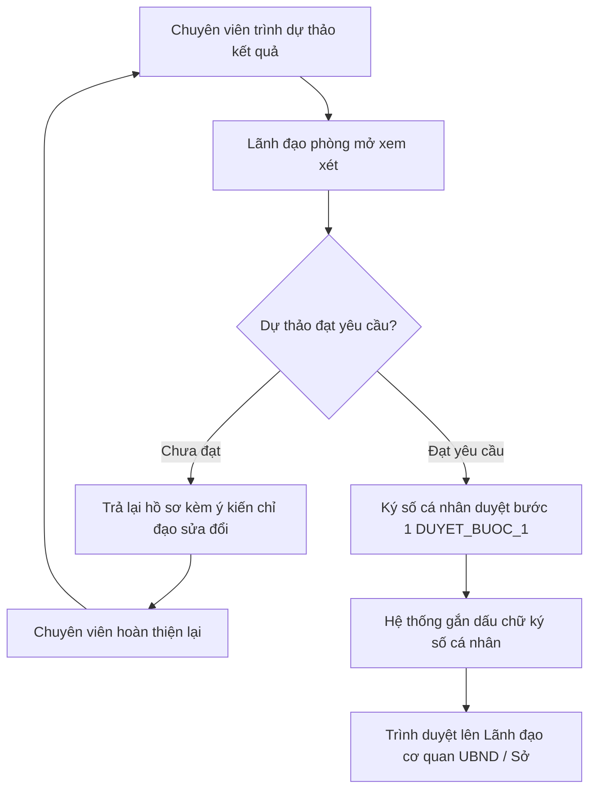

# TÀI LIỆU HƯỚNG DẪN SỬ DỤNG HỆ THỐNG HP-eGov
## DÀNH CHO: LÃNH ĐẠO PHÒNG CHUYÊN MÔN (LD_PHONG)
**Tài khoản mẫu:** `ldphong.hongbang` | **Mật khẩu:** `Hpegov@2026`  
**Phiên bản:** v1.0.0 | **Ngày ban hành:** Tháng 10/2026

---

### I. MỤC TIÊU & NHIỆM VỤ CỦA LÃNH ĐẠO PHÒNG
Lãnh đạo phòng chuyên môn (Trưởng/Phó phòng ban cấp Huyện hoặc cấp Sở) có nhiệm vụ:
1. Phân công hồ sơ mới tiếp nhận cho các chuyên viên trong phòng.
2. Thẩm định kết quả thẩm tra do chuyên viên trình lên.
3. Ký số duyệt bước 1 (`DUYET_BUOC_1`) trên văn bản dự thảo bằng chứng thư số cá nhân theo thẩm quyền.
4. Trình hồ sơ đã ký duyệt bước 1 lên Lãnh đạo cơ quan (Chủ tịch/Phó Chủ tịch UBND Quận/Huyện, Giám đốc/Phó Giám đốc Sở).
5. Trả lại hồ sơ cho chuyên viên nếu dự thảo chưa đạt yêu cầu, kèm ý kiến chỉ đạo chỉnh sửa.
6. Theo dõi tiến độ giải quyết của phòng qua biểu đồ cảnh báo SLA thời gian thực.

---

### II. QUY TRÌNH THẨM ĐỊNH & KÝ SỐ BƯỚC 1

---

### III. HƯỚNG DẪN THAO TÁC CHI TIẾT

#### 1. Đăng nhập & Xem danh sách hồ sơ chờ duyệt
1. Đăng nhập tài khoản: `ldphong.hongbang` / `Hpegov@2026`.
2. Vào menu **"Phê duyệt & Ký số"** $\rightarrow$ **"Hồ sơ chờ thẩm định"** (`/admin/phe-duyet`).
3. Màn hình liệt kê các hồ sơ do chuyên viên trong phòng trình lên, sắp xếp theo thứ tự ưu tiên thời hạn cam kết SLA.

#### 2. Thẩm định nội dung hồ sơ & dự thảo kết quả
1. Nhấn vào hồ sơ cần duyệt để xem toàn bộ lịch sử luân chuyển, ý kiến chuyên môn của chuyên viên, các tài liệu đính kèm và văn bản phản hồi phối hợp liên sở (nếu có).
2. Nhấn vào tệp dự thảo kết quả để xem trước trực tiếp trên trình duyệt.

#### 3. Ký số cá nhân phê duyệt bước 1 (`DUYET_BUOC_1`)
1. Sau khi kiểm tra dự thảo hoàn toàn chính xác, nhấn nút **"✍️ Ký số Duyệt bước 1"**.
2. Hệ thống mở hộp thoại xác nhận ký số:
   - Hiển thị thông tin chứng thư số: Chủ thể (*Phạm Đức Minh - Trưởng phòng TN&MT*), Nhà cung cấp (*OpenSSL / SmartCA*), Số Serial chứng thư.
   - Nhập mã PIN ký số cá nhân (mã mặc định môi trường demo: `123456`).
3. Nhấn **"Xác nhận ký số"**:
   - Hệ thống tự động tính mã băm SHA-256 của văn bản, tạo chữ ký số RSA-SHA256, lưu vào bảng `chu_ky_so` và tạo tệp `.sig` xác thực.
   - Khối con dấu chữ ký điện tử trực quan được tự động chèn vào cuối văn bản hiển thị rõ họ tên, chức danh và dấu thời gian ký số.

#### 4. Trình hồ sơ lên Lãnh đạo cơ quan
1. Sau khi ký số duyệt bước 1 thành công, nhấn nút **"Trình Lãnh đạo cơ quan"**.
2. Chọn Lãnh đạo cơ quan phê duyệt (ví dụ: *Lê Ngọc Tân - Phó Chủ tịch UBND Quận*).
3. Nhập ý kiến trình ký (nếu có) và nhấn **"Xác nhận chuyển"**.
4. Hồ sơ ngay lập tức chuyển sang bàn làm việc của Lãnh đạo cơ quan; trạng thái hồ sơ chuyển thành `CHO_PHE_DUYET`.

#### 5. Trả lại hồ sơ yêu cầu chuyên viên chỉnh sửa
1. Nếu phát hiện sai sót số liệu hoặc căn cứ pháp lý, nhấn nút **"Trả lại hồ sơ"**.
2. Nhập nội dung yêu cầu sửa đổi chi tiết vào ô ghi chú.
3. Nhấn **"Xác nhận trả lại"**. Hồ sơ quay về trạng thái `DANG_THU_LY` của chuyên viên thụ lý ban đầu kèm cảnh báo chỉ đạo.
