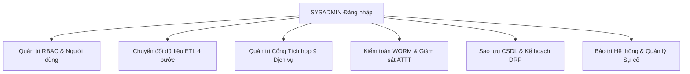

# TÀI LIỆU HƯỚNG DẪN SỬ DỤNG HỆ THỐNG HP-eGov
## DÀNH CHO: QUẢN TRỊ VIÊN HỆ THỐNG (SYSADMIN)
**Tài khoản mẫu:** `sysadmin` | **Mật khẩu:** `Hpegov@2026`  
**Phiên bản:** v1.0.0 | **Ngày ban hành:** Tháng 10/2026

---

### I. MỤC TIÊU & NHIỆM VỤ CỦA QUẢN TRỊ VIÊN
Quản trị viên hệ thống (thuộc Sở Thông tin và Truyền thông hoặc Trung tâm CNTT&TT) chịu trách nhiệm vận hành toàn diện hạ tầng và ứng dụng:
1. Quản trị phân quyền người dùng theo mô hình RBAC đa cấp.
2. Vận hành quy trình chuyển đổi dữ liệu ETL 4 bước từ hệ thống cũ.
3. Quản trị kết nối Cổng Tích hợp 9 dịch vụ nền tảng (LGSP, C06, VNeID, SmartCA, VNPost, v.v.).
4. Giám sát an toàn thông tin Cấp độ 3, rà soát nhật ký kiểm toán WORM và phát hiện can thiệp CSDL.
5. Thực hiện chính sách sao lưu và phục hồi thảm họa định kỳ (RPO $\le 2$h, RTO $\le 4$h).
6. Bật/tắt chế độ bảo trì hệ thống và ghi nhận sổ theo dõi sự cố an ninh mạng (BCP/DRP).
7. **Nguyên tắc phân tách đặc quyền bắt buộc:** SYSADMIN bị cấm tuyệt đối khỏi quyền nghiệp vụ hồ sơ và quyền ký số.

---

### II. CÁC PHÂN HỆ QUẢN TRỊ CHÍNH

---

### III. HƯỚNG DẪN THAO TÁC CHI TIẾT

#### 1. Quản trị người dùng & Phân quyền RBAC đa cấp
1. Vào menu **"Hệ thống"** $\rightarrow$ **"Người dùng & Phân quyền"** (`/admin/he-thong/nguoi-dung`).
2. Quản lý tài khoản cán bộ: Thêm mới, chỉnh sửa đơn vị công tác chính, khóa/mở khóa tài khoản khi bị brute-force.
3. Gán vai trò theo đơn vị: Một cán bộ có thể đảm nhiệm vai trò tương ứng với đơn vị làm việc. Quyền hạn kế thừa theo cây đơn vị và bảng ma trận `nguoi_dung_vai_tro`.

#### 2. Vận hành ETL Pipeline chuyển đổi dữ liệu cũ (5 năm)
1. Vào menu **"Hệ thống"** $\rightarrow$ **"Chuyển đổi dữ liệu ETL"** (`/admin/he-thong/etl`).
2. Thực hiện theo **Wizard 4 bước:**
   - **Bước 1 - Extract:** Chọn tệp CSV trích xuất từ MS SQL / MySQL cũ (hoặc dùng tệp mẫu có sẵn) và thư mục tệp đính kèm. Khởi tạo lô.
   - **Bước 2 - Staging & Profiling:** Xem bảng phân tích dữ liệu rác, hồ sơ trùng lặp, thiếu CCCD. Xuất danh sách lỗi ra CSV nếu cần.
   - **Bước 3 - Transform:** Ánh xạ mã TTHC cũ sang mã quốc gia, mã ĐVHC cũ sang mã TCTK; hệ thống chuẩn hóa định dạng ngày tháng và họ tên Title Case.
   - **Bước 4 - Load & Verify:** Nạp vào bảng chính theo lô (50 bản ghi/chunk), đối soát mã băm SHA-256 của 100% tệp đính kèm. Xem báo cáo nghiệm thu nạp dữ liệu.

#### 3. Quản trị Cổng Tích hợp 9 dịch vụ nền tảng
1. Vào menu **"Hệ thống"** $\rightarrow$ **"Cổng tích hợp & Kết nối"** (`/admin/he-thong/tich-hop`).
2. Xem trạng thái 9 dịch vụ: VNeID, LGSP Hải Phòng, C06, CSDL TTHC QG, SmartCA, SMS Brandname, Zalo ZNS, VNPost, ClamAV.
3. Nhấn **"Kiểm tra kết nối (Ping Test)"** để đo độ trễ mạng thực tế của từng dịch vụ.
4. Chuyển đổi linh hoạt giữa chế độ `MOCK` (thử nghiệm an toàn) và `LIVE` (đấu nối thật).
5. Quản lý danh sách API Token cấp cho đối tác ngoại vi và cấu hình Webhook LGSP xác thực HMAC-SHA256.

#### 4. Tra cứu Nhật ký Kiểm toán Bất biến WORM (Audit Trail)
1. Vào menu **"An toàn thông tin"** $\rightarrow$ **"Nhật ký kiểm toán"** (`/admin/he-thong/audit`).
2. Lọc nhật ký theo Người dùng, Hành động, Bảng tác động và Khoảng thời gian; xem chi tiết diff dữ liệu cũ/mới (JSON).
3. Nhấn nút **"🛡️ Kiểm tra toàn vẹn chuỗi băm WORM"**: Hệ thống tính toán tuần tự chuỗi SHA-256 từ bản ghi khởi tạo (Genesis) đến hiện tại để phát hiện ngay lập tức nếu CSDL bị can thiệp trực tiếp từ bên ngoài.

#### 5. Sao lưu & Phục hồi Thảm họa (Backup & Disaster Recovery)
1. Vào menu **"Hệ thống"** $\rightarrow$ **"Sao lưu & Phục hồi"** (`/admin/he-thong/sao-luu`).
2. Các chế độ sao lưu tự động:
   - **Full Backup:** 00:00 Chủ nhật hàng tuần (`mysqldump --single-transaction`, nén gz, tính SHA-256 và sao chép sang DR Site).
   - **Differential Backup:** 23:00 hàng ngày (xuất các bản ghi thay đổi theo `updated_at`, lưu giữ 30 ngày).
   - **Transaction Log:** Mỗi 2 giờ (hướng dẫn cấu hình Binary Log `mysqlbinlog`).
3. Nhấn nút **"Sao lưu Full ngay bây giờ"** để tạo bản snapshot dự phòng thủ công trước các đợt nâng cấp lớn.

#### 6. Chế độ Bảo trì Hệ thống & Quản lý Sự cố
1. **Chế độ bảo trì:** Khi nâng cấp hạ tầng, SYSADMIN kích hoạt cờ bảo trì (`public/maintenance.html`). Hệ thống chuyển hướng toàn bộ người dùng sang trang thông báo trang nhã, chỉ cho phép IP quản trị truy cập.
2. **Sổ theo dõi sự cố:** Vào `/admin/he-thong/su-co` để ghi nhận các sự cố gián đoạn (đứt cáp, lỗi mạng, DDoS) và biện pháp khắc phục theo chuẩn RACI phục vụ đánh giá năng lực an toàn thông tin Cấp độ 3.
