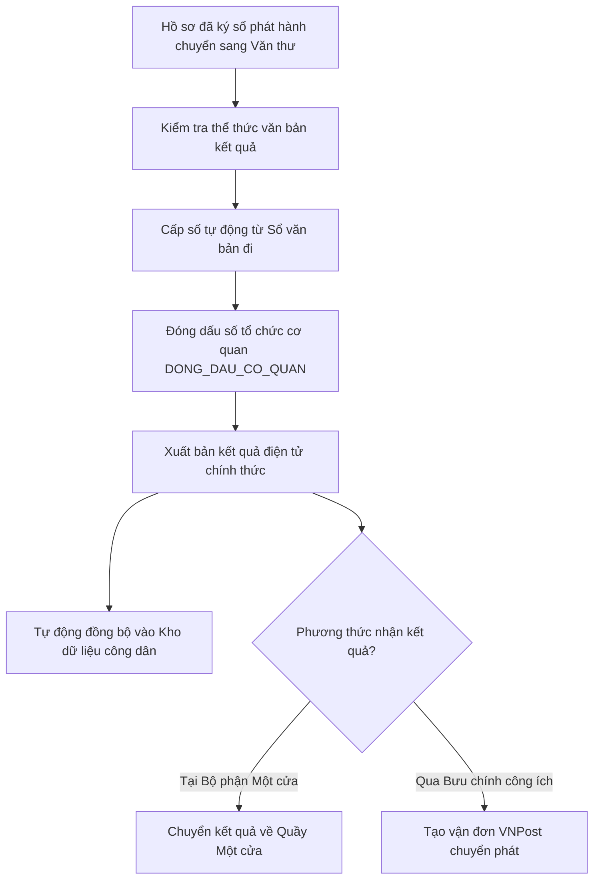

# TÀI LIỆU HƯỚNG DẪN SỬ DỤNG HỆ THỐNG HP-eGov
## DÀNH CHO: VĂN THƯ SỐ CƠ QUAN (VAN_THU)
**Tài khoản mẫu:** `vanthu.hongbang` | **Mật khẩu:** `Hpegov@2026`  
**Phiên bản:** v1.0.0 | **Ngày ban hành:** Tháng 10/2026

---

### I. MỤC TIÊU & NHIỆM VỤ CỦA VĂN THƯ SỐ
Văn thư số phụ trách khâu hoàn tất thể thức văn bản điện tử và phát hành kết quả chính thức:
1. Tiếp nhận các kết quả giải quyết TTHC đã được Lãnh đạo cơ quan ký số phát hành.
2. Cấp số tự động theo Sổ văn bản điện tử đi của cơ quan, đảm bảo không trùng số và không nhảy số.
3. Đóng dấu số cơ quan (`DONG_DAU_CO_QUAN`) bằng chứng thư số tổ chức do Ban Cơ yếu Chính phủ cấp.
4. Phát hành văn bản kết quả điện tử chính thức lên Cổng Dịch vụ công và đồng bộ vào Kho dữ liệu số hóa của công dân.
5. In kết quả bản giấy (nếu công dân đăng ký nhận trực tiếp tại Một cửa) hoặc tạo vận đơn bàn giao cho Bưu điện công ích VNPost.

---

### II. QUY TRÌNH VĂN THƯ SỐ ĐÓNG DẤU & PHÁT HÀNH

---

### III. HƯỚNG DẪN THAO TÁC CHI TIẾT

#### 1. Đăng nhập & Quản lý hàng đợi văn thư
1. Đăng nhập với tài khoản: `vanthu.hongbang` / `Hpegov@2026`.
2. Vào menu **"Văn thư số"** $\rightarrow$ **"Hồ sơ chờ đóng dấu & phát hành"** (`/admin/van-thu`).
3. Màn hình hiển thị danh sách các kết quả TTHC đã có chữ ký số của Lãnh đạo UBND Quận / Sở.

#### 2. Cấp số văn bản điện tử tự động
1. Nhấn vào hồ sơ cần phát hành.
2. Tại mục thông tin phát hành:
   - Hệ thống tự động chọn Sổ văn bản đi tương ứng (ví dụ: *Sổ Giấy phép xây dựng năm 2026*, hoặc *Sổ Quyết định hành chính*).
   - Nhấn nút **"Lấy số tự động"**: Cơ chế transaction CSDL khóa bản ghi cấp số tự tăng không bao giờ bị trùng lặp hoặc nhảy số (ví dụ: cấp số `142/GP-UBND`).
   - Ngày ban hành tự động lấy thời điểm hiện tại.

#### 3. Đóng dấu số cơ quan (`DONG_DAU_CO_QUAN`)
1. Nhấn nút **"🔴 Đóng dấu số cơ quan"**.
2. Hệ thống sử dụng chứng thư số tổ chức (Con dấu số pháp nhân `UBND Quận Hồng Bàng` do Ban Cơ yếu cấp) để ký số:
   - Tính toán mã băm SHA-256 của tệp tin sau khi ghép số văn bản.
   - Chèn hình ảnh **Con dấu đỏ điện tử** của cơ quan lên vị trí quy định góc trên bên phải chữ ký của Lãnh đạo cơ quan theo đúng thể thức văn bản hành chính quy định tại Nghị định 30/2020/NĐ-CP.
   - Ghi nhật ký vào bảng `chu_ky_so` với loại chữ ký `DONG_DAU_CO_QUAN`.

#### 4. Phát hành kết quả & Trả công dân
1. Nhấn nút **"Phát hành kết quả"**:
   - Trạng thái hồ sơ chuyển thành `HOAN_THANH` và ghi nhận `ngay_hoan_thanh = NOW()`.
   - Kết quả bản điện tử (PDF kèm chữ ký số và con dấu đỏ) tự động xuất hiện trên Cổng DVC công khai để công dân tải về.
   - Giấy tờ kết quả tự động đồng bộ vào **Kho dữ liệu điện tử cá nhân** của công dân (`kho_du_lieu_cong_dan`) phục vụ tái sử dụng.
   - Hệ thống tự động đẩy tin nhắn SMS Brandname và Zalo ZNS thông báo cho công dân kèm mã QR tra cứu.
2. Nếu công dân đăng ký nhận qua đường bưu điện, Văn thư nhấn **"Tạo vận đơn VNPost"** để in phiếu gửi bưu chính công ích.
