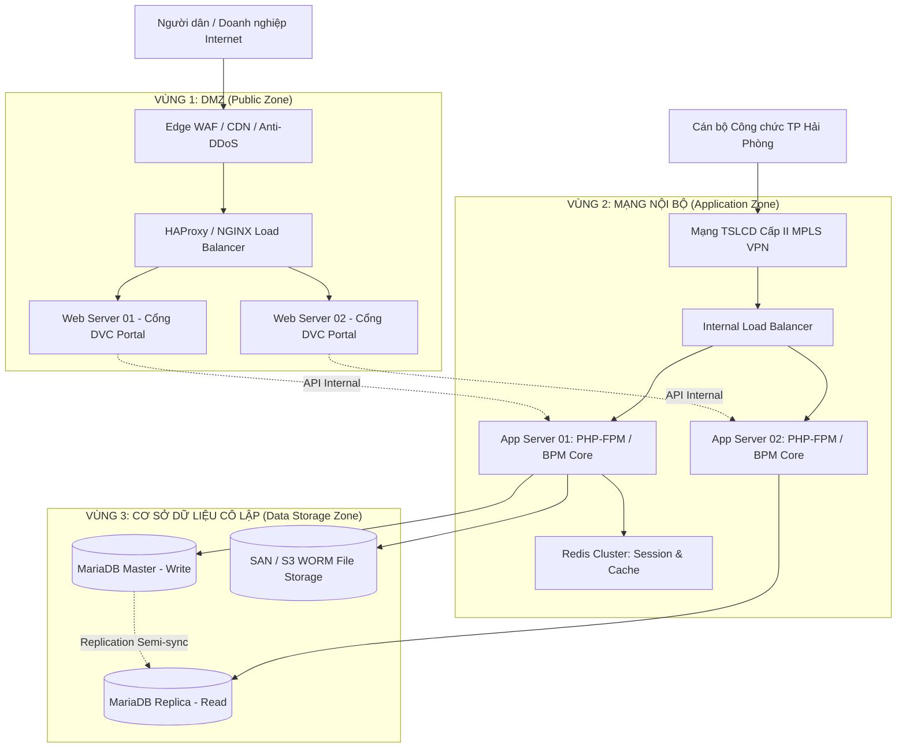

# HƯỚNG DẪN TRIỂN KHAI VẬN HÀNH MÔI TRƯỜNG PRODUCTION
## HỆ THỐNG MỘT CỬA ĐIỆN TỬ LIÊN THÔNG TP. HẢI PHÒNG (HP-eGov)
**Căn cứ kỹ thuật:** Báo cáo Kiến trúc Chương 1 §1.1, §1.2 & Chương 4 §4.3, §4.4  
**Tiêu chuẩn bảo mật:** An toàn thông tin Cấp độ 3 (Nghị định 85/2016/NĐ-CP)  
**Phiên bản:** v1.0.0 | **Ngày ban hành:** Tháng 10/2026

---

### I. MÔ HÌNH KIẾN TRÚC MẠNG 3 VÙNG (3-TIER NETWORK TOPOLOGY)

Hệ thống HP-eGov khi triển khai tại Trung tâm Tích hợp Dữ liệu TP. Hải Phòng (Data Center Sở TT&TT) được phân vùng nghiêm ngặt qua hệ thống Firewall thế hệ mới (Next-Gen Firewall):



#### Quy tắc kiểm soát luồng tường lửa (Firewall Rules):
1. **Edge $\rightarrow$ DMZ:** Chỉ cho phép cổng 443 (HTTPS) và 80 (chuyển hướng 301 sang 443).
2. **DMZ $\rightarrow$ App Zone:** Chỉ cho phép giao tiếp HTTP/2 nội bộ trên cổng 8080/9000 qua giao thức mTLS; chặn hoàn toàn kết nối trực tiếp từ DMZ vào CSDL.
3. **App Zone $\rightarrow$ Data Zone:** Chỉ cho phép cổng 3306 (MySQL) từ địa chỉ IP của các App Server được cấp phép trong Whitelist.
4. **Vùng quản trị (Out-of-Band):** Chỉ mở SSH (Port 2222) và VPN bảo mật xác thực 2 yếu tố (2FA OTP) dành riêng cho SYSADMIN Sở TT&TT.

---

### II. GIẢI PHÁP TĂNG CƯỜNG SẴN SÀNG CAO (HIGH AVAILABILITY - HA)

#### 1. Cụm Cân bằng tải dự phòng (Keepalived + HAProxy)
- Hai máy chủ cân bằng tải (LB-01 Master và LB-02 Backup) chạy Keepalived chia sẻ chung một địa chỉ IP ảo (Virtual IP - VIP: `10.31.0.100`).
- Thời gian phát hiện lỗi và chuyển đổi dự phòng (Failover): $< 1.0$ giây.

**Cấu hình mẫu Keepalived (`/etc/keepalived/keepalived.conf`):**
```ini
vrrp_script check_haproxy {
    script "killall -0 haproxy"
    interval 2
    weight 2
}

vrrp_instance VI_HPEGOV {
    state MASTER
    interface eth0
    virtual_router_id 51
    priority 101
    advert_int 1
    authentication {
        auth_type PASS
        auth_pass HpegovHa2026!
    }
    virtual_ipaddress {
        10.31.0.100/24
    }
    track_script {
        check_haproxy
    }
}
```

#### 2. Cụm Cơ sở dữ liệu Master – Replica (Failover < 30 giây)
- Sử dụng mô hình **Semi-Synchronous Replication** giữa Node Master (Ghi) và Node Replica (Đọc).
- Tích hợp **ProxySQL** hoặc **Orchestrator** tự động thăng cấp Replica lên làm Master khi Master vật lý bị sự cố; cập nhật DNS nội bộ trong vòng 15–30 giây, đảm bảo cam kết RTO $\le 4$ giờ và RPO $\approx 0$.

---

### III. CẤU HÌNH MẪU MÁY CHỦ SẢN XUẤT (NGINX & PHP-FPM)

#### 1. Cấu hình NGINX Reverse Proxy với Header Bảo mật & CSP
Tệp cấu hình: `/etc/nginx/sites-available/hpegov.conf`:
```nginx
server {
    listen 80;
    server_name dichvucong.haiphong.gov.vn motcua.haiphong.gov.vn;
    return 301 https://$host$request_uri;
}

server {
    listen 443 ssl http2;
    server_name dichvucong.haiphong.gov.vn motcua.haiphong.gov.vn;

    root /var/www/HP-eGov/public;
    index index.php;

    # Chứng chỉ số SSL/TLS 1.3
    ssl_certificate /etc/ssl/certs/haiphong_gov_vn.crt;
    ssl_certificate_key /etc/ssl/private/haiphong_gov_vn.key;
    ssl_protocols TLSv1.2 TLSv1.3;
    ssl_ciphers ECDHE-ECDSA-AES128-GCM-SHA256:ECDHE-RSA-AES128-GCM-SHA256;
    ssl_prefer_server_ciphers on;
    ssl_session_cache shared:SSL:10m;
    ssl_session_timeout 1d;

    # Security Headers (An toàn thông tin Cấp độ 3)
    add_header X-Frame-Options "DENY" always;
    add_header X-Content-Type-Options "nosniff" always;
    add_header X-XSS-Protection "1; mode=block" always;
    add_header Referrer-Policy "strict-origin-when-cross-origin" always;
    add_header Content-Security-Policy "default-src 'self'; script-src 'self' 'unsafe-inline'; style-src 'self' 'unsafe-inline'; img-src 'self' data:; font-src 'self'; connect-src 'self'; frame-ancestors 'none';" always;
    add_header Strict-Transport-Security "max-age=31536000; includeSubDomains; preload" always;

    # Rate Limiting Layer 7 tại Nginx
    limit_req zone=hpegov_rate_limit burst=20 nodelay;

    # Chặn tuyệt đối truy cập các thư mục nhạy cảm
    location ~ ^/(app|database|storage|cron|docs|\.git) {
        deny all;
        return 403;
    }

    location ~ /\.(?!well-known).* {
        deny all;
        return 403;
    }

    # Tối ưu hóa Static Assets
    location ~* \.(jpg|jpeg|png|gif|ico|css|js|woff2|webp)$ {
        expires 30d;
        add_header Cache-Control "public, no-transform";
    }

    # Điều hướng về Front Controller
    location / {
        try_files $uri $uri/ /index.php?$query_string;
    }

    # PHP-FPM Handler
    location ~ \.php$ {
        include fastcgi_params;
        fastcgi_pass unix:/run/php/php8.2-fpm.sock;
        fastcgi_index index.php;
        fastcgi_param SCRIPT_FILENAME $document_root$fastcgi_script_name;
        fastcgi_param APP_ENV production;
        fastcgi_param APP_DEBUG false;
        fastcgi_read_timeout 60s;
        fastcgi_buffer_size 128k;
        fastcgi_buffers 4 256k;
    }
}
```

#### 2. Cấu hình PHP-FPM Pool (`/etc/php/8.2/fpm/pool.d/hpegov.conf`)
```ini
[hpegov]
user = www-data
group = www-data
listen = /run/php/php8.2-fpm.sock
listen.owner = www-data
listen.group = www-data
listen.mode = 0660

pm = dynamic
pm.max_children = 120
pm.start_servers = 20
pm.min_spare_servers = 10
pm.max_spare_servers = 30
pm.max_requests = 1000

php_admin_value[memory_limit] = 256M
php_admin_value[upload_max_filesize] = 20M
php_admin_value[post_max_size] = 25M
php_admin_value[max_execution_time] = 60
php_admin_flag[expose_php] = off
php_admin_flag[display_errors] = off
php_admin_value[session.cookie_httponly] = 1
php_admin_value[session.cookie_secure] = 1
php_admin_value[session.cookie_samesite] = Lax
```

---

### IV. LỘ TRÌNH TRIỂN KHAI 3 GIAI ĐOẠN THEO BÁO CÁO KIẾN TRÚC

```text
2026                  Q1 - Q2                 Q3                     Q4
                     GIAI ĐOẠN 1            GIAI ĐOẠN 2            GIAI ĐOẠN 3
                  [HẠ TẦNG & THỬ NGHIỆM]   [NHÂN RỘNG ĐỊA BÀN]    [TỐI ƯU & HOÀN THIỆN]
-------------------------------------------------------------------------------------
Hạ tầng:          Private Cloud Hải Phòng  Mở rộng DR Site        Đấu nối NDXP toàn quốc
Triển khai:       Thí điểm Hồng Bàng, GTVT 15 Quận/Huyện, 18 Sở   TP Thủy Nguyên mới
Dữ liệu:          ETL 5 năm lịch sử        Đồng bộ kho số hóa     AI phân tích tiến độ
ATTT:             Kiểm thử Cấp độ 3        Diễn tập DRP định kỳ   Cấp chứng chỉ Quốc gia
```

#### Giai đoạn 1: Thiết lập nền tảng & Thí điểm (Tháng 1 - Tháng 6/2026)
- Xây dựng cụm máy chủ Private Cloud tại Trung tâm Tích hợp Dữ liệu Hải Phòng.
- Triển khai toàn bộ mã nguồn lõi HP-eGov (15 phân hệ).
- Chuyển đổi dữ liệu lịch sử 5 năm qua ETL Pipeline và đối soát toàn vẹn SHA-256.
- Thử nghiệm thực địa 30 ngày tại UBND Quận Hồng Bàng và Sở GTVT.

#### Giai đoạn 2: Nhân rộng toàn thành phố (Tháng 7 - Tháng 9/2026)
- Triển khai diện rộng trên toàn bộ 15 quận/huyện, thị xã và 18 sở, ban, ngành.
- Đào tạo chuẩn hóa 4 nhóm cán bộ theo Báo cáo §1.4.
- Đấu nối chính thức trục LGSP Hải Phòng với CSDL Quốc gia về Dân cư (C06) và Cổng DVC Quốc gia.

#### Giai đoạn 3: Tối ưu hóa & Khai thác thông minh (Tháng 10 - Tháng 12/2026)
- Đưa Trung tâm IOC Hải Phòng vào vận hành giám sát thời gian thực cấp Thành phố.
- Tái sử dụng 100% kết quả giải quyết TTHC qua Kho dữ liệu điện tử của công dân.
- Thực hiện diễn tập an toàn thông tin thực chiến và chuyển đổi dự phòng thảm họa (DRP) hàng năm.
